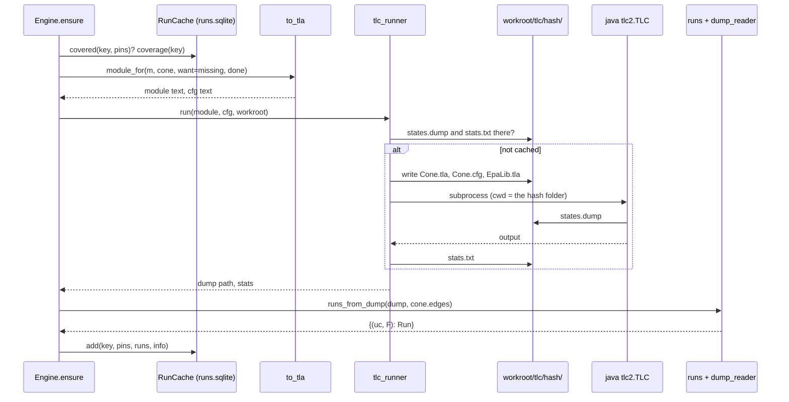

# The alethic layer: TLA+ and TLC

Part of the [developer guide](../developer-guide.md). Files: `epa/translate/to_tla.py`,
`epa/alethic/tlc_runner.py`, `epa/alethic/dump_reader.py`, `epa/alethic/runs.py`,
`epa/alethic/tla_lib/EpaLib.tla` (the `__init__.py` files are empty). Line numbers are left out on
purpose: `python tools/inventory.py` prints the current ones.

## 1. Purpose

### epa/translate/to_tla.py
Turns one cone of a loaded `Model` into the text of a TLA+ module and a TLC configuration. The
reachable states of that module are the runs: Init chooses a use case and a firing choice F ⊆
`cone.rows`. Values are written into defined operators (there is no `CONSTANTS` section), and the
output is deterministic for a model, a cone and its pin sets, which the hash-keyed TLC cache relies on.
Pin sets `{row: A|N}` limit which firing choices are explored (`want`) or skipped as already explored
(`done`). Callers: `Engine.ensure` (with the pin sets the run cache lacks) and `python -m epa tla MODEL
CELL`.

### epa/alethic/tlc_runner.py
Runs TLC (Java) on a generated module. It writes the module, the cfg and a copy of `EpaLib.tla` into
`<workroot>/tlc/<hash>/`, where `<hash>` covers the module, the cfg and the library, so an identical
request is answered from disk without starting Java. It returns the path of TLC's state dump and the
statistics. Callers: `Engine.ensure` and `/api/health` (`java_ok`, `find_jar`); `Engine.trace_of`
rebuilds the dump path itself.

### epa/alethic/dump_reader.py
Parses the file TLC writes with `-dump states` (blocks of `State N:` and `/\ var = value` lines). A
tokenizer and a small recursive-descent parser map TLA+ values to Python: records and functions →
dict, sets of scalars → frozenset (other sets → tuple), sequences → tuple, strings, integers and
booleans. Two streaming generators read a dump one state at a time. Used by `runs.py` only.

### epa/alethic/runs.py
Turns explored states into runs and reads facts off a run. The `Run` dataclass is keyed by
`(uc, fire)`. `runs_from_dump` keeps the terminal (`done = TRUE`) states; `trace` replays one run's
intermediate states; `used`, `reaches` and `severity` judge a cell at its point; `matches` checks a
run against a witness. Used by the coordinator and by the run cache.

### epa/alethic/tla_lib/EpaLib.tla
The hand-written library every generated module extends: `Max`, `Min`, `Sat` (cap at 10), `MaxSet`,
the token join `JoinTok`/`JoinAll`, the label merge `MergeLab`, and `AtLeastAsBad`. Labels only grow,
so every run ends in the least fixpoint. Its text is part of the cache hash.

## 2. Definitions

### epa/translate/to_tla.py

| Definition | What it does | Calls |
|---|---|---|
| `q(s)` | `s` in double quotes, as a TLA+ string literal (quotes inside are not escaped). | — |
| `_set(xs)` | A TLA+ set literal `{"a", "b"}`, in the input order. | to_tla.q |
| `_ident(s)` | Replaces every character outside `[A-Za-z0-9_]` with `_` (for operator and LET names). | — |
| `_vector_pred(name, pin_sets, vec_rows)` | The line `name(F) == …`: FALSE with no pin sets, else one disjunct per pin set (`{rows pinned A} \subseteq F /\ F \cap {rows pinned N} = {}`). | to_tla._set |
| `_bexpr(parts)` | A token's `b` function from `[(field, expr)]`, as a `CASE` over `ModeSet` (all zero when empty). | — |
| `module_for(m, cone, want, done, schedule, name)` | The entry point: emits the whole module (header, constants, `Start`, `MaxPhase`, one `Outs_<c>` per cone component, `Step`, variables, `Init`, `Round`, `Next`, `Spec`) and returns `(module text, "SPECIFICATION Spec\nCHECK_DEADLOCK FALSE\n")`. Raises ValueError for an edge id that is not an identifier. `schedule` is not read. | to_tla._set, to_tla._vector_pred, to_tla.guard_strata, to_tla._component |
| `module_for.tok_expr(tok)` (nested) | A use-case token as a TLA+ record (only non-zero cone fields in `b`). | to_tla._bexpr |
| `guard_strata(m, cone)` | `{guard: phase}` for the cone's droppers (guards not on a cycle that may receive a non-normal message); each phase is one more than the highest dropper upstream of it. Caches `normal_edges`/`possible` on the model. | cone.normal_edges, cone.possible, cone.upstream |
| `guard_strata.may_drop(g)` (nested) | Whether some edge into the guard can carry a message that is not on the normal flow, in some use case. | load.Model.edges_into |
| `guard_strata.s(g)` (nested) | The memoised phase of a dropper (cycles stopped by a provisional 0). | cone.upstream |
| `_component(m, c, cone, fields, vec_rows, always, in_cone, L, stratum)` | Appends the operator `Outs_<c>(lab, F, ph)`: from the current labels, the label `c` sends on each output and the set of its non-always rows that fired. Separate branches for guards and other components (section 3). | cone.forwarding, load.Model.edges_into, load.Model.family, to_tla._ident, to_tla._set, to_tla._bexpr |
| `_component.eff(tok, mode)` (nested) | The TLA+ expression of a mode's effective magnitude (the max over its family). | load.Model.family |
| `_component.sunk(p, f)` (nested) | The condition under which a firing sink row absorbs field `f` arriving at port `p`. | — |

### epa/alethic/tlc_runner.py

| Definition | What it does | Calls |
|---|---|---|
| `find_jar()` | `$TLA2TOOLS`, else the repository's `vendor/tla2tools.jar`, else `./vendor/tla2tools.jar`; FileNotFoundError otherwise. | — |
| `java_ok()` | Runs `java -version` and returns `(ok, the version line)`. | — |
| `TLCError` | Raised when TLC's output lacks the success markers; carries the end of the output. | — |
| `run(module_text, cfg_text, workroot, name, workers, timeout)` | With `states.dump` and `stats.txt` already in `<workroot>/tlc/<hash>/`, returns them without Java; otherwise writes the files, runs TLC there (900 s timeout), checks the success markers, saves the output to `stats.txt`, deletes `meta/`; returns `(dump path, stats)`. | tlc_runner.find_jar, tlc_runner._parse_stats |
| `_parse_stats(out)` | `generated`, `distinct`, `depth`, `initial` and `tlc_version` from TLC's output. | — |

### epa/alethic/dump_reader.py

| Definition | What it does | Calls |
|---|---|---|
| `_tokens(s)` | Splits value text into tokens (`<<`, `>>`, `\|->`, `:>`, `@@`, strings, integers, TRUE, FALSE, identifiers, brackets). | — |
| `_P` | A recursive-descent parser over the tokens. | — |
| `_P.__init__`, `_P.peek`, `_P.take` | Holds the tokens and a cursor; looks at and consumes a token (checking it if asked). | — |
| `_P.value` | Parses one value: records and functions → dict, sets → frozenset or tuple, sequences → tuple, booleans, strings, integers. | _P.peek, _P.take |
| `parse_value(s)` | Tokenizes and parses one value. | dump_reader._tokens, dump_reader._P |
| `parse_labels(s, cache)` | Function text `("e1" :> […] @@ …)` per edge, parsing each distinct label once; anything else through `parse_value`. | dump_reader.parse_value |
| `read_dump_raw(path)` | Yields `{var: value text}` per state, without parsing. | — |
| `read_dump(path, wanted)` | Yields `{var: value}` per state, parsing the wanted variables. | dump_reader.parse_value |
| `read_dump.flush()` (nested) | Stores the variable being collected into the current state. | dump_reader.parse_value |

### epa/alethic/runs.py

| Definition | What it does | Calls |
|---|---|---|
| `Run` | Dataclass: `uc`, `fire` (the firing choice), `fired` (rows that fired on the final labels), `labels` (edge → `{u, n, k}`), `rounds`, `terminal_variants`. | — |
| `Run.key` | `(uc, fire)`. | — |
| `runs_from_dump(dump_path, keep_edges)` | Streams the dump, keeps the `done = TRUE` states, and returns `{(uc, fire): Run}` with the labels of `keep_edges`; a second terminal state with other labels for one key increments `terminal_variants`. | dump_reader.read_dump_raw, dump_reader.parse_value, dump_reader.parse_labels |
| `trace(dump_path, uc, fire, edges)` | One run's states in round order, as `[{round, fired, labels}]`, skipping steps that changed nothing. | dump_reader.read_dump |
| `effective(m, tok, mode)` | The max magnitude over the mode's family. | load.Model.family |
| `used(m, cell, run)` | Whether the point's edge carries a message in the run. | — |
| `reaches(m, cell, run)` | Whether the failure reaches the point: magnitude ≥ tolerated, taint, confidentiality above the clearance, authority below the requirement. | runs.effective |
| `severity(m, cell, run)` | The magnitude, or the distance beyond the level, at the point (0 if unused). | runs.effective |
| `witness_fields_for_cell(m, cone, cell, witness, rel)` | Projects a witness onto one cell. Not called. | load.Model.family |
| `matches(m, projected, run, use_case)` | Whether a run matches a witness: the use case, the `used` bit, the logged magnitude ranges, taint, confidentiality and authority at each logged point. | runs.effective |

### EpaLib.tla

| Operator | What it does |
|---|---|
| `Max`, `Min` | of two integers |
| `Sat(v)` | `Min(v, 10)`: caps a magnitude (used for `+k`) |
| `MaxSet(S)` | the max of a set of integers, 0 for `{}` |
| `JoinTok(x, y)` | the join of two tokens: `b` field-wise max, `c` max, `a` min, `t` or |
| `JoinAll(S, bot)` | `JoinTok` folded over a set |
| `MergeLab(l, o)` | merges a sent label into an edge's label (only if it is used) |
| `AtLeastAsBad(x, y)` | x is at least as bad as y; not used |

## 3. The generated TLA+ module

```
---------------------------- MODULE Cone ----------------------------
EXTENDS Naturals, FiniteSets, EpaLib
ModeSet  == {<cone fields>}
ATop     == <top authority index>
T0       == [b |-> [f \in ModeSet |-> 0], c |-> 0, a |-> ATop, t |-> FALSE]
NoMsg    == [u |-> FALSE, n |-> FALSE, k |-> T0]
Edges    == {<cone edges>}            VecRows == {<cone rows>}         UseCases == {...}
Want(F)  == <pin sets to explore>     Done(F) == <pin sets already explored>
Vectors  == {F \in SUBSET VecRows : Want(F) /\ ~Done(F)}
Start(x) == CASE x = "<uc>" -> [e \in Edges |-> IF e = "<entry edge>" THEN [u |-> TRUE, n |-> TRUE, k |-> <token>] ELSE NoMsg] [] ...
MaxPhase == <highest guard stratum, or 0>
Outs_<c>(lab, F, ph) == LET ... IN [<out port> |-> <label>, ..., fired |-> <rows>]      \* one per component
Step(lab, F, ph) == [lab |-> [e \in Edges |-> MergeLab(lab[e], <what its source sends>)], fired |-> ...]
VARIABLES uc, fire, lab, fired, rnd, done, phase
Init  == uc \in UseCases /\ fire \in Vectors /\ lab = Start(uc) /\ fired = {} /\ rnd = 0 /\ done = FALSE /\ phase = 0
Round == ~done /\ LET s == Step(lab, fire, phase) IN lab' = s.lab /\ fired' = s.fired
         /\ IF s.lab = lab THEN (IF phase = MaxPhase THEN done' = TRUE ELSE phase' = phase + 1) ELSE ...
Next == Round        Spec == Init /\ [][Next]_vars
```

The cfg is `SPECIFICATION Spec` / `CHECK_DEADLOCK FALSE`: TLC is used only to list the reachable
states.

* **Labels and tokens.** A label is `[u, n, k]`: `u` the edge carries a message, `n` the message is on
  the normal flow (a guard drops only a message whose `n` is false), `k` the token `[b, c, a, t]`: `b`
  the magnitude of every field (0..10; a mode's effective magnitude is the max over its family), `c`
  the confidentiality level (joined by max), `a` the authority (merged by min, so the top is neutral),
  `t` taint (or).
* **Init** picks a use case and a firing choice, so there are |UseCases| × |Vectors| initial states.
  Rows fixed always are not in `VecRows`; they fire whenever their condition holds. Rows outside the
  cone never fire.
* **Pin sets.** `Want(F)` holds if F agrees with a pin set to explore, `Done(F)` if it agrees with one
  already explored; with the defaults every one of the 2^|VecRows| choices is explored.
* **One round.** Every component computes `Outs_<c>` from the same labels (synchronous), and each sent
  label is merged into its edge. For a component, a row `R` matches (`m_R`) when its ports are used and
  its patterns hold, `v_R` is the matched magnitude, and `f_R` (fires) is `m_R` and, unless fixed
  always, `"R" \in F`. An output sends when a flow input is used or a forwarding or emitting row fires;
  its magnitudes are the passed-through ones (unless a firing sink absorbs them) and the emitted ones
  (`const k` → k, `keep`/`max` → `v_R`, `+k` → `Sat(v_R + k)`); the authority is lowered to the
  component's unless it raises its own; an untrusted component taints.
* **Guards.** For each target, present (`p_R`), leaking (`f_R`, the leak row fires) or caught
  (`c_R`). A catch caps the mode's family at threshold − 1, sets conf or auth to the level, or clears
  taint. A guard not on a cycle drops a message that is not normal when it catches something. A
  learned guard's fp row raises omission.
* **Phases.** A dropper waits for its phase (`ph ≥ stratum`), so it reads its input only after
  everything upstream has settled. A round that changes nothing advances the phase; at `MaxPhase` the
  run is done.
* **Termination.** Each initial state starts one deterministic chain that ends in exactly one `done`
  state, which has no successor (hence no deadlock check).

## 4. Running TLC

```
java -XX:+UseParallelGC -Xss16m -cp <tla2tools.jar> tlc2.TLC -deadlock \
     -workers auto -dump states -config Cone.cfg -metadir <wd>/meta Cone.tla
```

```
<workroot>/                       $EPA_WORK or .epa-work
  runs.sqlite                     the run cache (engine/cache.py)
  workspace.json                  the shared workspace (epa/workspace.py)
  tlc/<hash>/                     hash = sha256(module + cfg + EpaLib.tla)[:16]
    Cone.tla  Cone.cfg  EpaLib.tla
    states.dump                   written by TLC
    stats.txt                     TLC's whole output, written after a successful run
```

A request is answered from disk when `states.dump` and `stats.txt` exist. This is the second cache
level; the first is the SQLite run cache keyed by the cone's behaviour hash and the pin sets, which
`Engine.ensure` checks before generating a module. `java` is looked up on `PATH`. Success means the
output contains "No error has been found" or "Model checking completed"; otherwise `TLCError`.

## 5. Reading runs

The dump holds one block per distinct state; long values wrap onto continuation lines.
`runs_from_dump` parses only the terminal states (`done = TRUE`): one `Run` per `(uc, fire)` with the
labels of the cone's edges. `effective` gives a mode's magnitude (the max over its family), matching the
TLA+ `eff`. `used`, `reaches` and `severity` read the label at the point's edge; the coordinator turns
them into the run facts for clingo. `matches` decides whether a run is the one a witness logged (use
case, `used`, magnitude ranges; taint and levels when the point is used).

## 6. Workflow: the coordinator asks for the runs of a cone

1. `Cone.key(m)`; the run cache answers whether every wanted pin set is covered. If so, nothing runs.
2. `to_tla.module_for(m, cone, want=missing, done=covered)` returns the module and the cfg.
3. `tlc_runner.run` hashes them; a hit on disk returns the dump at once; otherwise it writes the files
   and starts Java, which writes `states.dump`.
4. `runs.runs_from_dump(dump, cone.edges)` reads the terminal states into `Run`s.
5. The run cache stores the runs and the covered pin sets; `tlc-done` is emitted.



## 7. Observations

* **Not used**: `runs.witness_fields_for_cell` (callers pass the raw `w["at"]` to `matches`),
  `AtLeastAsBad`, the `schedule` argument of `module_for`, the `vec_rows` argument of `_component`.
* **Errors**: `TLCError` is not caught specifically (the API's analysis thread reports any exception);
  a timeout raises `subprocess.TimeoutExpired`; TLC's exit code is not checked.
* **The disk cache key** leaves out the TLC jar version and the JVM flags: upgrading
  `vendor/tla2tools.jar` reuses old dumps.
* **`parse_labels`' per-edge cache** is not used with the current TLC, which prints `lab` in record
  syntax.
* **`terminal_variants > 1` cannot arise** from the generated module (each initial state has one
  terminal state).
* **`keep` and `max`** produce the same TLA+ (the max of the matched magnitudes).
* **Names**: `q()` does not escape quotes, and `_ident()` can map two ids to one TLA+ name (`a.b` and
  `a_b`); only edge ids are checked.
* **`trace`** parses every state of the dump to keep one run: slow on large dumps.
* **No use case**: a cone with no use case would emit `Start(x) == CASE` with no arms (invalid TLA+);
  the model check requires at least one use case, so this does not happen through the workbench.
