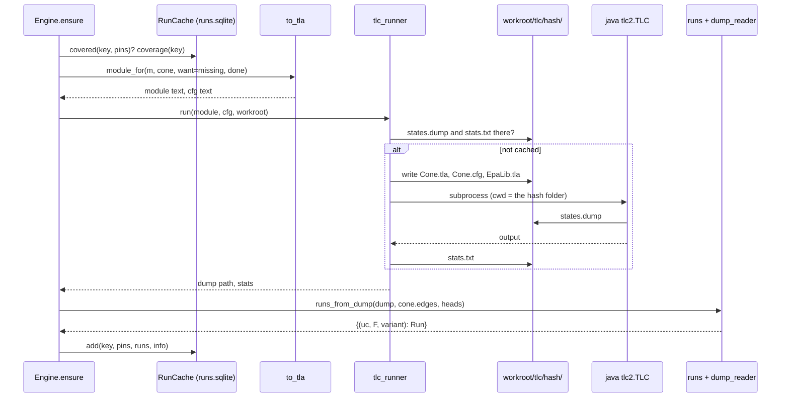

# The alethic layer: TLA+ and TLC

Part of the [developer guide](../developer-guide.md). Files: `epa/translate/to_tla.py`,
`epa/alethic/tlc_runner.py`, `epa/alethic/dump_reader.py`, `epa/alethic/runs.py`,
`epa/alethic/tla_lib/EpaLib.tla` (the `__init__.py` files are empty). Line numbers are left out on
purpose: `python tools/inventory.py` prints the current ones.

## 1. Purpose

### epa/translate/to_tla.py
Turns one cone of a loaded `Model` into the text of a TLA+ module and a TLC configuration. TLC does not
define the firing rule; it explores it. The module says what the state is (the queues and the monitors)
and gives one step per component, "this component fires", enabled when it is ready; TLC tries every
enabled step from every state, so it walks every firing order. Init chooses a use case and a switch
vector F ⊆ `cone.rows`. Values are written into defined operators (there is no `CONSTANTS` section), and
the output is deterministic for a model, a cone and its pin sets, which the hash-keyed TLC cache relies
on. Pin sets `{row: A|N}` limit which switch vectors are explored (`want`) or skipped as already
explored (`done`). `schedule` picks the translator: `fifo` (the default, section 3) or `rounds` (the
older monotone fixpoint, kept for the differential test, section 3b). Callers: `Engine.ensure` (with the
pin sets the run cache lacks) and `python -m epa tla MODEL CELL`.

### epa/alethic/tlc_runner.py
Runs TLC (Java) on a generated module. It writes the module, the cfg and a copy of `EpaLib.tla` into
`<workroot>/tlc/<hash>/`, where `<hash>` covers the module, the cfg and the library, so an identical
request is answered from disk without starting Java. It returns the path of TLC's state dump and the
statistics. Callers: `Engine.ensure` and `/api/health` (`java_ok`, `find_jar`); `Engine.trace_of`
rebuilds the dump path itself.

### epa/alethic/dump_reader.py
Parses the file TLC writes with `-dump states` (blocks of `State N:` and `/\ var = value` lines). A
tokenizer and a small recursive-descent parser map TLA+ values to Python: records and functions →
dict, sets of scalars → frozenset (other sets → tuple), sequences → tuple, strings, integers and
booleans. Two streaming generators read a dump one state at a time. Used by `runs.py` only.

### epa/alethic/runs.py
Turns explored states into runs and reads facts off a run. The `Run` dataclass is keyed by
`(uc, fire, variant)`: one use case and switch vector can have several outcomes. `runs_from_dump` keeps
the terminal (`done = TRUE`) states and collects the head combinations of every state; `trace` rebuilds
one run step by step; `used`, `reaches` and `severity` judge a cell at its point; `races` and `race_at`
find order dependence; `matches` checks a run against a witness. Used by the coordinator and by the run
cache.

### epa/alethic/tla_lib/EpaLib.tla
The hand-written library every generated module extends: `Max`, `Min`, `Sat` (cap at 10), `MaxSet`,
the token join `JoinTok`/`JoinAll`, the label merge `MergeLab`, `AtLeastAsBad`, and for fifo the queue
step `Pop` and the stopping rule `Deliver`. Its text is part of the cache hash.

## 2. Definitions

### epa/translate/to_tla.py

| Definition | What it does | Calls |
|---|---|---|
| `q(s)` | `s` in double quotes, as a TLA+ string literal (quotes inside are not escaped). | — |
| `_set(xs)` | A TLA+ set literal `{"a", "b"}`, in the input order. | to_tla.q |
| `_ident(s)` | Replaces every character outside `[A-Za-z0-9_]` with `_` (for operator and LET names). | — |
| `_vector_pred(name, pin_sets, vec_rows)` | The line `name(F) == …`: FALSE with no pin sets, else one disjunct per pin set (`{rows pinned A} \subseteq F /\ F \cap {rows pinned N} = {}`). | to_tla._set |
| `_bexpr(parts)` | A token's `b` function from `[(field, expr)]`, as a `CASE` over `ModeSet` (all zero when empty). | — |
| `port_key(comp, port)` | The name of an input port's queue in the module, `<comp>__<port>`. | to_tla._ident |
| `module_for(m, cone, want, done, schedule, name)` | The entry point: checks the edge ids (ValueError for one that is not an identifier) and calls the translator `schedule` names (default: the model's, else `cone.default_schedule`). Returns `(module text, "SPECIFICATION Spec\nCHECK_DEADLOCK FALSE\n")`. | to_tla._fifo_module, to_tla._rounds_module |
| `_common(m, cone, want, done, name)` | The lines both translators start with, up to `Vectors`; returns them with the fields and use cases. | to_tla._set, to_tla._vector_pred |
| `_tok_expr(tok, fields, track)` | A use-case token as a TLA+ record (only non-zero cone fields in `b`; fields `track` leaves out are constant). | to_tla._bexpr |
| `_rounds_module(m, cone, want, done, name)` | The rounds module (section 3b). | to_tla._common, to_tla._tok_expr, to_tla.guard_strata, to_tla._component |
| `_tracked(m, cone, in_cone)` | Which of `c`, `a`, `t` and the normal bit the tokens of this cone need (section 5). | — |
| `_solo(m, cone, comps, ready)` | For each component, the text of the condition under which it alone is explored from a state (section 5). | to_tla.port_key |
| `_solo.reach(start, avoid)` (nested) | The components a token can reach from `start` without passing through `avoid`. | — |
| `_fifo_module(m, cone, want, done, name)` | The fifo module (section 3). | to_tla._common, to_tla._tracked, to_tla._tok_expr, to_tla._component, to_tla._solo, to_tla.port_key |
| `_fifo_module.queue_of(eid)` (nested) | The queue an edge ends in, `""` if it leaves the cone. | to_tla.port_key |
| `_fp_magnitude(c, fifo)` | The omission a learned guard's false positive causes: as declared, else present (rounds: 10). | — |
| `guard_strata(m, cone)` | `{guard: phase}` for the cone's droppers (guards not on a cycle that may receive a non-normal message); each phase is one more than the highest dropper upstream of it. Caches `normal_edges`/`possible` on the model. | cone.normal_edges, cone.possible, cone.upstream |
| `guard_strata.may_drop(g)` (nested) | Whether some edge into the guard can carry a message that is not on the normal flow, in some use case. | load.Model.edges_into |
| `guard_strata.s(g)` (nested) | The memoised phase of a dropper (cycles stopped by a provisional 0). | cone.upstream |
| `_component(m, c, cone, fields, always, in_cone, L, stratum, track)` | Appends the operator `Outs_<c>`: what `c` sends on each output and the set of its non-always rows that applied. It reads the heads of `c`'s queues under fifo (`track` given, `Outs_<c>(Q, F, S)`) and the edge labels under rounds (`Outs_<c>(lab, F, ph)`). Separate branches for guards and other components (section 3). | cone.forwarding, load.Model.edges_into, load.Model.family, to_tla._ident, to_tla._set, to_tla._bexpr, to_tla._fp_magnitude, to_tla.port_key |
| `_component.eff(tok, mode)` (nested) | The TLA+ expression of a mode's effective magnitude (the max over its family). | load.Model.family |
| `_component.sunk(p, f)` (nested) | The condition under which a firing sink row absorbs field `f` arriving at port `p`. | — |

### epa/alethic/tlc_runner.py

| Definition | What it does | Calls |
|---|---|---|
| `find_jar()` | `$TLA2TOOLS`, else the repository's `vendor/tla2tools.jar`, else `./vendor/tla2tools.jar`; FileNotFoundError otherwise. | — |
| `java_ok()` | Runs `java -version` and returns `(ok, the version line)`. | — |
| `TLCError` | Raised when TLC's output lacks the success markers; carries the end of the output. | — |
| `run(module_text, cfg_text, workroot, name, workers, timeout)` | With `states.dump` and `stats.txt` already in `<workroot>/tlc/<hash>/`, returns them without Java; otherwise writes the files, runs TLC there (900 s timeout), checks the success markers, saves the output to `stats.txt`, deletes `meta/`; returns `(dump path, stats)`. | tlc_runner.find_jar, tlc_runner._parse_stats |
| `_parse_stats(out)` | `generated`, `distinct`, `depth`, `initial` and `tlc_version` from TLC's output. | — |

### epa/alethic/dump_reader.py

| Definition | What it does | Calls |
|---|---|---|
| `_tokens(s)` | Splits value text into tokens (`<<`, `>>`, `\|->`, `:>`, `@@`, strings, integers, TRUE, FALSE, identifiers, brackets). | — |
| `_P` | A recursive-descent parser over the tokens. | — |
| `_P.__init__`, `_P.peek`, `_P.take` | Holds the tokens and a cursor; looks at and consumes a token (checking it if asked). | — |
| `_P.value` | Parses one value: records and functions → dict, sets → frozenset or tuple, sequences → tuple, booleans, strings, integers. | _P.peek, _P.take |
| `parse_value(s)` | Tokenizes and parses one value. | dump_reader._tokens, dump_reader._P |
| `parse_labels(s, cache)` | Function text `("e1" :> […] @@ …)` per edge, parsing each distinct label once; anything else through `parse_value`. | dump_reader.parse_value |
| `read_dump_raw(path)` | Yields `{var: value text}` per state, without parsing. | — |
| `read_dump(path, wanted)` | Yields `{var: value}` per state, parsing the wanted variables. | dump_reader.parse_value |
| `read_dump.flush()` (nested) | Stores the variable being collected into the current state. | dump_reader.parse_value |

### epa/alethic/runs.py

| Definition | What it does | Calls |
|---|---|---|
| `Run` | Dataclass: `uc`, `fire` (the switch vector), `fired` (rows that applied), `labels` (edge → `{u, n, k}`), `rounds` (rounds schedule only), `terminal_variants` (how many outcomes this `(uc, fire)` has), `variant` (which one this is). | — |
| `Run.key` | `(uc, fire, variant)`. | — |
| `_note_heads(q, heads, cache)` | Adds the head combination of every component in one queue state to `heads`. | dump_reader.parse_value |
| `runs_from_dump(dump_path, keep_edges, heads)` | Streams the dump, keeps the `done = TRUE` states, and returns one `Run` per distinct outcome (`fired`, labels of `keep_edges`) of each `(uc, fire)`. `heads`, if given, collects the head combinations of every state. | dump_reader.read_dump_raw, dump_reader.parse_value, dump_reader.parse_labels, runs._note_heads |
| `_states_of(dump_path, uc, fire)` | The parsed states of one use case and switch vector. | dump_reader.read_dump_raw, dump_reader.parse_value |
| `trace(dump_path, uc, fire, edges, labels, sources)` | One run as `[{round, fired, labels, component?}]`. Under fifo a consistent path ending in the outcome `labels`, rebuilt from the states, every firing a step; `sources` names the sender of each edge. Under rounds it skips rounds that changed no edge. | runs._states_of, runs._fifo_path |
| `_consumed(s)` | How much of a run has happened in a state (tokens taken off queues, internal faults applied); every firing raises it. | — |
| `_fired_by(a, b, sources)` | The component whose firing leads from state `a` to state `b`, or None: one component took heads and every edge that delivered is its own. | — |
| `_fifo_path(states, edges, labels, sources)` | Depth-first search through the states of one `(uc, fire)` from the initial state to a terminal one with these labels. | runs._consumed, runs._fired_by |
| `_fifo_path.walk(i, path)` (nested) | One step of that search. | runs._fired_by |
| `races(m, cell, runs)` | Pairs (a run that reaches, one that uses the point clean) of one use case and switch vector. | runs.used, runs.reaches |
| `race_at(m, a, b)` | The component where two such runs part (same on every input edge, different on an output), and the ports it took; None if a loop hides it. | load.Model.comp_rows, load.Model.edges_into |
| `race_at.inputs(c)` (nested) | The cone's edges into each input port of `c`. | load.Model.edges_into |
| `effective(m, tok, mode)` | The max magnitude over the mode's family. | load.Model.family |
| `used(m, cell, run)` | Whether the point's edge carries a message in the run. | — |
| `reaches(m, cell, run)` | Whether the failure reaches the point: magnitude ≥ tolerated, taint above `tolerate_taint`, confidentiality above the clearance, authority below the requirement. | runs.effective |
| `severity(m, cell, run)` | What the ranking weighs: the model's `severity` of the worst mode of the family present at the point (a mode without one: its magnitude), or the distance beyond the level for provenance; taint above the tolerated level counts 1. 0 if unused. | — |
| `witness_fields_for_cell(m, cone, cell, witness, rel)` | Projects a witness onto one cell. Not called. | load.Model.family |
| `_taint_matches(level, logged, tolerated)` | A log says true or false (beyond what the point accepts or not) or a level or a range. | — |
| `matches(m, projected, run, use_case)` | Whether a run matches a witness: the use case, the `used` bit, the logged magnitude ranges, taint, confidentiality and authority at each logged point. | runs.effective, runs._taint_matches |

### EpaLib.tla

| Operator | What it does |
|---|---|
| `Max`, `Min` | of two integers |
| `Sat(v)` | `Min(v, 10)`: caps a magnitude (used for `+k`) |
| `MaxSet(S)` | the max of a set of integers, 0 for `{}` |
| `JoinTok(x, y)` | the join of two tokens: `b` field-wise max, `c` max, `a` min, `t` max |
| `JoinAll(S, bot)` | `JoinTok` folded over a set |
| `MergeLab(l, o)` | merges a sent label into an edge's label (only if it is used) |
| `AtLeastAsBad(x, y)` | x is at least as bad as y; not used |
| `Pop(Q, ports)` | the queues with the head of every non-empty queue of `ports` removed |
| `Deliver(s, e, port, o)` | the stopping rule: if `o` is sent and edge `e` has not carried that value in this run, append it to the queue `port` (none for `""`), add it to `seen[e]`, merge it into `lab[e]` |

## 3. The fifo module

```
---------------------------- MODULE Cone ----------------------------
EXTENDS Naturals, FiniteSets, Sequences, EpaLib
ModeSet, ATop, T0, NoMsg, Edges, VecRows, UseCases, Want, Done, Vectors        \* as for rounds
Ports    == {<queue of every input port of the cone that an edge of the cone ends in>}
Start(x) == CASE x = "<uc>" -> [q |-> ..., seen |-> ..., lab |-> ...] [] ...
VARIABLES uc, fire, q, seen, lab, fired, spent, done
Outs_<c>(Q, F, S) == LET ... IN [p_<out port> |-> [u, n, k], ..., fired |-> <rows>, spent |-> <faults>]
Ready_<c>(Q, S)   == <a queue of c is non-empty, or a switched-on internal fault is not yet in S>
Quiet(Q, S)       == <no component is ready>
Commit(s, o)      == q' = s.q /\ seen' = s.seen /\ lab' = s.lab /\ fired' = fired \cup o.fired
                     /\ spent' = spent \cup o.spent /\ done' = Quiet(s.q, ...) /\ UNCHANGED <<uc, fire>>
Fire_<c> == Ready_<c>(q, spent) /\ LET o == Outs_<c>(q, fire, spent)
                                       s0 == [q |-> Pop(q, <c's queues>), seen |-> seen, lab |-> lab]
                                       s1 == Deliver(s0, "<edge>", "<queue>", o.p_<port>) ...
                                   IN Commit(sn, o)
Init == uc \in UseCases /\ fire \in Vectors /\ <q, seen, lab from Start(uc)> /\ fired = {} /\ spent = {} /\ done = Quiet(...)
Solo_<c> == <section 5>
Next == IF Solo_a THEN Fire_a ELSE IF Solo_b THEN Fire_b ... ELSE Fire_a \/ Fire_b \/ ...
Spec == Init /\ [][Next]_vars /\ WF_vars(Next)
```

The cfg is `SPECIFICATION Spec` / `CHECK_DEADLOCK FALSE`: TLC lists the reachable states. There is no
clock, no round and no phase in the module.

* **State.** A FIFO queue per input port, `q`, holding messages `[n, k]`: `n` the normal bit (the message
  does not exist only because a failure row made it), `k` the token `[b, c, a, t]`. `b` holds one number
  per mode field, 0 absent and 1 present by default, larger on a refined scale; `c` the confidentiality
  level, `a` the authority, `t` the taint level 0..3. Monitors: `seen[e]` the message values edge `e` has
  delivered, `lab[e]` the label `[u, n, k]` with the field-wise worst token delivered, `fired` the open
  rows that applied, `spent` the internal faults applied, `done` no component is ready.
* **Arrival** only appends to a queue. **A step** fires one ready component. **A firing** removes the
  head of every non-empty queue of the component and applies its table to those heads, reading nothing
  else: a component has no memory. It sends one token per output port written: the failures of the
  ports that forward there (unless a sink row that applied absorbs them), joined with what the rows that
  applied emit, so merging into the worse value happens inside a firing and never across firings. `c`
  is the join of the heads, `t` the join of the heads and the component's own taint level, `a` the
  meet of the heads and the component's authority (its authority alone if it `raises`).
* **Matching.** A row applies in a firing if it is switched on (in F, or fixed always) and all its ports
  have a matching head. So a row naming two ports matches only when both tokens stand at the heads in
  one firing. `"*"` matches any head.
* **Internal faults** (rows with an empty `when`). A switched-on one makes its component ready until it
  has applied. It applies in the first firing of its component, with or without heads, once per run.
* **The stopping rule.** `Deliver` does not deliver a value the edge has already carried in this run: it
  adds no new type of error. Components stay memoryless; this is the analysis remembering. Values are
  compared exactly, normal bit included.
* **Starting tokens** sit on the edges leaving their system input and count as delivered. **Fan-out:** one
  output port delivers on each of its edges, each edge applying the stopping rule on its own. **Several
  edges into one port** share one queue. Tokens that arrive in one firing, or start on one port, queue
  in the order of the cone's edges and of the entries; the case models have neither.
* **Guards** read their single head. A target present with its leak row off is caught: the mode (with
  its family) is removed, taint is lowered to k−1, confidentiality to the level, authority raised to
  the level. A caught message whose normal bit is false is dropped, unless the guard is on a cycle. A
  learned guard's false-positive row adds omission.
* **Termination.** Modes, levels, edges and the normal bit are finite, so each edge delivers finitely
  many values. Every firing takes a token off a queue or applies an internal fault, and each internal
  fault applies once. So every run ends, in any order, and `WF_vars(Next)` adds nothing the analysis
  uses: it says that a ready component is not skipped for ever.
* **Reading a run.** Only terminal states are read. Different firing orders may end differently, and that
  difference is what a race is.

## 3b. The rounds module

`module_for(..., schedule="rounds")`, or `EPA_SCHEDULE=rounds`, gives the older translator, which
`tests/test_differential.py` compares with `tests/reference/`. Every component computes `Outs_<c>(lab, F,
ph)` from the same labels, each sent label is merged into its edge, and a round that changes nothing
advances the phase (a guard that may drop waits for its phase, `guard_strata`); at `MaxPhase` the run is
done. It has one outcome per `(uc, fire)`. It takes taint as a level like fifo, and keeps three things
the reference semantics assumes: default rows read as magnitude 10, a false positive as 10, a caught mode
as capped at threshold − 1, and only `trusted: false` or an external or user component taints.

## 4. Running TLC

```
java -XX:+UseParallelGC -Xss16m -cp <tla2tools.jar> tlc2.TLC -deadlock \
     -workers auto -dump states -config Cone.cfg -metadir <wd>/meta Cone.tla
```

```
<workroot>/                       $EPA_WORK or .epa-work
  runs.sqlite                     the run cache (engine/cache.py)
  workspace.json                  the shared workspace (epa/workspace.py)
  tlc/<hash>/                     hash = sha256(module + cfg + EpaLib.tla)[:16]
    Cone.tla  Cone.cfg  EpaLib.tla
    states.dump                   written by TLC
    stats.txt                     TLC's whole output, written after a successful run
```

A request is answered from disk when `states.dump` and `stats.txt` exist. This is the second cache
level; the first is the SQLite run cache keyed by the cone's behaviour hash and the pin sets, which
`Engine.ensure` checks before generating a module. `java` is looked up on `PATH`. Success means the
output contains "No error has been found" or "Model checking completed"; otherwise `TLCError`.

## 5. Reading runs, and why the reductions are sound

The dump holds one block per distinct state; long values wrap onto continuation lines.
`runs_from_dump` parses the terminal states (`done = TRUE`). Terminal states of one `(uc, fire)` with the
same `fired` and the same labels are one `Run`, with its own `variant`; a run in the sense of the paper is
(use case, switch vector, firing order), and runs with identical monitors are one run for the epistemic
layer. `effective` gives a mode's magnitude (the max over its family), matching the TLA+ `eff`. `used`,
`reaches` and `severity` read the label at the point's edge; the coordinator turns them into the run
facts for clingo, one fact set per distinct outcome. `matches` decides whether a run is the one a witness
logged. `trace` has no successor links to follow, because TLC dumps states only, so `_fifo_path` rebuilds
one firing order: a step goes from a state to a later one if exactly one component's heads left its
queues, only that component's edges delivered, and everything else only grew. No state variable exists
for this.

Firing orders multiply states, so the module uses two reductions. Both are switched on always;
`EPA_POR=0` turns the first off, and `tests/test_fifo.py` compares the two on the hub.

**One firing order for firings that cannot interact (`_solo`).** Say two firings of different components
*commute* if doing them in either order gives the same state. Component c's firing changes c's queues,
appends to the queues behind its output edges, and writes `seen`, `lab` on its own output edges and the
sets `fired`, `spent`. So firings of c and d fail to commute only if one appends to a queue of the other
that is empty when the other fires (the other's heads then differ) or both append to one queue. Appending
behind a head changes no head; `fired` and `spent` are unions; `seen` and `lab` of an edge have one writer.

Let R be everything that can fire before c does: the ready components other than c, and whatever a token
can reach from them without passing through c. `Solo_c` holds when c is ready, no component of R receives
from c, and no component of R feeds an empty queue of c. Then every firing that can happen before c fires
commutes with c's firing, and c stays ready, because only c takes from its queues. So {c} is a persistent
set (Godefroid), and exploring only c from this state loses no terminal state: take any run from the
state to an end. c must fire in it, or c would still be ready at the end. Every firing before that first
firing of c commutes with it, so moving it to the front gives a run with the same firings and the same
end. By induction the reduced graph holds a run equivalent to every complete run. The monitors are part
of the state and commute too, so the end states read, labels and `fired` included, are the same.

The same argument covers head combinations. In the full graph every combination at some state is a
firing that can happen, since a component with a non-empty queue may fire. Equivalent runs contain the
same firings, so every such firing occurs in the reduced graph, whose states therefore show every
combination; they show no other, being reachable. So completeness may read the reduced states.

**Tokens cut to what the cone reads (`_tracked`, `cone.fields`).** Tokens hold only the mode fields of
the cone, and `c`, `a`, `t` and the normal bit only if a cell of the cone reads them or a guard of the
cone tests them; nothing else in a cone reads them, since rows match on modes. Two tokens that differ
only in a dropped field are then one value, and the second is not delivered. A component is memoryless, so
that second firing could only have produced what the first did on the fields kept, unless it stood
beside other heads the first did not. So the reduction can lose one thing: a combination of heads on
a feedback loop that needs a token differing from an earlier one only outside the cone, where the second
head is caused by the first token. Only a row naming several ports, or a guard dropping one token and not
a merged one, can tell. This is the same trust the cone already puts in leaving rows out.

**Cones under fifo.** Two rules are added to the cone, and neither applies to rounds. A provenance cell
keeps a row that sends from a port with no forwarding to that output, if that row can send something
worse than the output gets without such rows (`_provenance_carriers`): under rounds every input was
joined into every label, under fifo a token carries the provenance of its own heads only. And a row that
can send a token of its own brings the guards off a cycle that this token can trigger, whatever the normal
flow does on that edge (`_guards_met`): the guard judges each token, so it may drop this one. `normal_edges`
still counts a fork-join as normal though a race may stop it; the case models have no fork-join.

## 6. Workflow: the coordinator asks for the runs of a cone

1. `Cone.key(m)` (it covers the schedule and the kinds of the cone's cells); the run cache answers
   whether every wanted pin set is covered. If so, nothing runs.
2. `to_tla.module_for(m, cone, want=missing, done=covered)` returns the module and the cfg.
3. `tlc_runner.run` hashes them; a hit on disk returns the dump at once; otherwise it writes the files
   and starts Java, which writes `states.dump`.
4. `runs.runs_from_dump(dump, cone.edges, heads)` reads the terminal states into `Run`s and the head
   combinations of every state.
5. The run cache stores the runs and the covered pin sets (the head combinations with the TLC info);
   `tlc-done` is emitted.



## 7. Observations

* **Not used**: `runs.witness_fields_for_cell` (callers pass the raw `w["at"]` to `matches`),
  `AtLeastAsBad`.
* **Dumps are large**: every distinct state is written in full, which is about 1.6 GB for a cold analysis
  of the smart-home model. `trace` and the head combinations read them; a workroot can be emptied at will.
* **Errors**: `TLCError` is not caught specifically (the API's analysis thread reports any exception);
  a timeout raises `subprocess.TimeoutExpired`; TLC's exit code is not checked.
* **The disk cache key** leaves out the TLC jar version and the JVM flags: upgrading
  `vendor/tla2tools.jar` reuses old dumps.
* **`parse_labels`' per-edge cache** is not used with the current TLC, which prints `lab` in record
  syntax.
* **`keep` and `max`** produce the same TLA+ (the max of the matched magnitudes).
* **Names**: `q()` does not escape quotes, and `_ident()` can map two ids to one TLA+ name (`a.b` and
  `a_b`); only edge ids are checked.
* **`trace`** scans the whole dump to keep one `(uc, fire)`: slow on large dumps.
* **No use case**: a cone with no use case would emit `Start(x) == CASE` with no arms (invalid TLA+);
  the model check requires at least one use case, so this does not happen through the reasoner.
