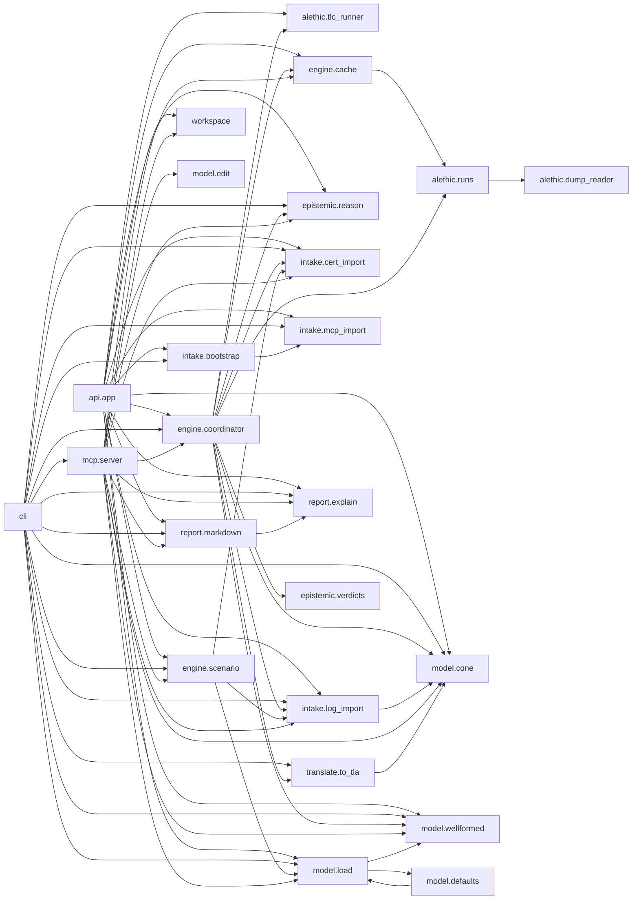
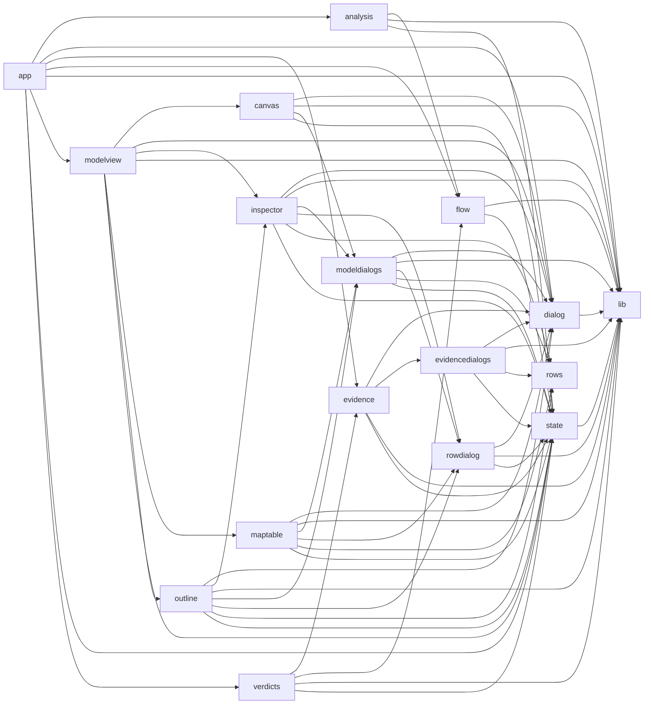

# Call graph

Generated by `python tools/inventory.py --md` from the code (Python by `ast`; calls are resolved through
each module's imports, so calls through objects other than `self` and dynamic calls are not listed).
Regenerate it after changing the code; `tests/test_docs.py` checks it is current.

## Module dependencies (epa/)

## Who calls whom (epa/)

| caller | calls |
|---|---|
| `alethic.dump_reader._P.value` | `alethic.dump_reader._P.peek`, `alethic.dump_reader._P.take` |
| `alethic.dump_reader.parse_labels` | `alethic.dump_reader.parse_value` |
| `alethic.dump_reader.parse_value` | `alethic.dump_reader._P`, `alethic.dump_reader._tokens` |
| `alethic.dump_reader.read_dump` | `alethic.dump_reader.parse_value` |
| `alethic.runs.matches` | `alethic.runs.effective` |
| `alethic.runs.reaches` | `alethic.runs.effective` |
| `alethic.runs.runs_from_dump` | `alethic.dump_reader.parse_labels`, `alethic.dump_reader.parse_value`, `alethic.dump_reader.read_dump_raw`, `alethic.runs.Run` |
| `alethic.runs.severity` | `alethic.runs.effective` |
| `alethic.runs.trace` | `alethic.dump_reader.read_dump` |
| `alethic.tlc_runner.run` | `alethic.tlc_runner.TLCError`, `alethic.tlc_runner._parse_stats`, `alethic.tlc_runner.find_jar` |
| `api.app._engine` | `engine.coordinator.Engine` |
| `api.app._model` | `model.load.load_model` |
| `api.app.case` | `api.app._case_dir`, `model.load.read_document` |
| `api.app.case_bundle` | `api.app._case_dir`, `engine.scenario.load_case` |
| `api.app.case_figure` | `api.app._case_dir` |
| `api.app.case_file` | `api.app._case_dir` |
| `api.app.case_stage` | `api.app._case_dir`, `engine.scenario.stage_inputs` |
| `api.app.cell_asp` | `api.app._engine`, `model.cone.cells`, `model.cone.cones` |
| `api.app.cell_trace` | `api.app._engine`, `report.explain.trace_story` |
| `api.app.do_bootstrap` | `intake.bootstrap.apply_answers`, `intake.bootstrap.questionnaire`, `intake.bootstrap.read_spans`, `intake.bootstrap.skeleton_from_mcp`, `intake.bootstrap.skeleton_from_traces`, `intake.mcp_import.read_tools_list`, `model.load.validate` |
| `api.app.evidence_certs` | `api.app._model`, `intake.cert_import.classify`, `intake.cert_import.load`, `intake.cert_import.reverify` |
| `api.app.evidence_logs` | `api.app._model`, `intake.log_import.classify_witness`, `intake.log_import.load_deployments`, `intake.log_import.load_recogniser`, `intake.log_import.recognise_all` |
| `api.app.evidence_register` | `api.app._model`, `engine.coordinator.Engine` |
| `api.app.evidence_witness` | `api.app._model`, `intake.log_import.classify_witness`, `intake.log_import.manual_witness` |
| `api.app.health` | `alethic.tlc_runner.find_jar`, `alethic.tlc_runner.java_ok` |
| `api.app.model_check` | `epistemic.reason.candidate_space`, `model.cone.cells`, `model.cone.cone_of_cell`, `model.load.load_model`, `model.load.validate`, `model.wellformed.absorbed` |
| `api.app.model_parse` | `model.load.read_document`, `model.load.validate` |
| `api.app.possibilities` | `api.app._engine` |
| `api.app.report_cra` | `report.markdown.cra_export` |
| `api.app.report_md` | `report.markdown.report` |
| `api.app.start_analysis` | `api.app._model`, `engine.coordinator.Engine` |
| `api.app.workspace_get` | `workspace.load` |
| `api.app.workspace_meta` | `workspace.meta` |
| `api.app.workspace_put` | `workspace.empty_evidence`, `workspace.meta`, `workspace.save` |
| `cli._engine` | `engine.coordinator.Engine` |
| `cli._print` | `report.explain.reason_line`, `report.markdown.cra_export`, `report.markdown.report` |
| `cli.main` | `cli._engine`, `cli._print`, `engine.scenario.load_case`, `engine.scenario.stage_inputs`, `epistemic.reason.candidate_space`, `intake.bootstrap.apply_answers`, `intake.bootstrap.questionnaire`, `intake.bootstrap.read_spans`, `intake.bootstrap.skeleton_from_mcp`, `intake.bootstrap.skeleton_from_traces`, `intake.cert_import.load`, `intake.log_import.load_deployments`, `intake.log_import.load_recogniser`, `intake.log_import.recognise_all`, `intake.mcp_import.read_tools_list`, `mcp.server.Workbench`, `mcp.server.build_server`, `model.cone.cells`, `model.cone.cone_of_cell`, `model.cone.cones`, `model.load.load_model`, `model.wellformed.absorbed`, `translate.to_tla.module_for` |
| `engine.cache.RunCache.covered` | `engine.cache.RunCache.coverage`, `engine.cache.covers` |
| `engine.cache.RunCache.runs` | `alethic.runs.Run` |
| `engine.coordinator.Engine.__init__` | `engine.cache.RunCache` |
| `engine.coordinator.Engine.analyse` | `engine.coordinator.Engine.applies`, `engine.coordinator.Engine.decide`, `engine.coordinator.Engine.emit`, `engine.coordinator.Engine.ensure`, `engine.coordinator.Engine.pins`, `engine.coordinator.Engine.rank`, `engine.coordinator.Engine.register`, `engine.coordinator.Engine.suspension`, `engine.coordinator._count_vectors`, `engine.coordinator.judge_claims`, `model.cone.cells`, `model.cone.cones`, `model.wellformed.absorbed` |
| `engine.coordinator.Engine.applies` | `engine.coordinator.Engine.inert` |
| `engine.coordinator.Engine.decide` | `engine.coordinator.Engine.applies`, `engine.coordinator.Engine.emit`, `engine.coordinator.Engine.ensure`, `engine.coordinator.Engine.inert`, `engine.coordinator.Engine.problem`, `engine.coordinator.Engine.reasons`, `engine.coordinator.Engine.witnesses_on`, `engine.coordinator._minimal`, `epistemic.reason.candidate_space`, `epistemic.verdicts.advice`, `epistemic.verdicts.statuses_for_display`, `epistemic.verdicts.verdict_of` |
| `engine.coordinator.Engine.ensure` | `alethic.runs.runs_from_dump`, `alethic.tlc_runner.run`, `engine.coordinator.Engine.emit`, `engine.coordinator._count_vectors`, `translate.to_tla.module_for` |
| `engine.coordinator.Engine.inert` | `model.cone._trigger_possible`, `model.cone.normal_edges`, `model.cone.possible` |
| `engine.coordinator.Engine.possibilities` | `engine.coordinator.Engine.applies`, `engine.coordinator.Engine.ensure`, `engine.coordinator.Engine.problem`, `engine.coordinator.Engine.register`, `engine.coordinator.Engine.suspension`, `engine.coordinator.Engine.wcone`, `engine.coordinator.Engine.witness_runs`, `engine.coordinator.Engine.witnesses_on`, `epistemic.reason.candidate_space`, `model.cone.cells`, `model.cone.cones` |
| `engine.coordinator.Engine.problem` | `alethic.runs.reaches`, `alethic.runs.severity`, `alethic.runs.used`, `engine.coordinator.Engine.applies`, `engine.coordinator.Engine.wcone`, `engine.coordinator.Engine.witness_runs`, `epistemic.reason.CellProblem` |
| `engine.coordinator.Engine.rank` | `engine.coordinator.Engine.emit`, `engine.coordinator.Engine.problem`, `engine.coordinator.Engine.witnesses_on`, `epistemic.verdicts.verdict_of` |
| `engine.coordinator.Engine.reasons` | `engine.coordinator.Engine.ensure`, `engine.coordinator.Engine.pins`, `engine.coordinator.Engine.problem`, `engine.coordinator.Engine.witnesses_on`, `epistemic.verdicts.verdict_of` |
| `engine.coordinator.Engine.register` | `intake.cert_import.classify`, `intake.cert_import.reverify`, `intake.log_import.classify_witness` |
| `engine.coordinator.Engine.suspension` | `alethic.runs.matches`, `engine.coordinator.Engine.emit`, `engine.coordinator.Engine.ensure`, `engine.coordinator.Engine.witness_cone`, `engine.coordinator.Engine.witnesses_on`, `epistemic.reason.CellProblem` |
| `engine.coordinator.Engine.trace_of` | `alethic.runs.trace`, `model.cone.cells`, `model.cone.cones` |
| `engine.coordinator.Engine.vacuous` | `engine.coordinator.Engine.wcone` |
| `engine.coordinator.Engine.wcone` | `engine.coordinator.Engine.witness_cone` |
| `engine.coordinator.Engine.witness_cone` | `model.cone.Cell`, `model.cone.Cone`, `model.cone.cone_of_cell` |
| `engine.coordinator.Engine.witness_runs` | `alethic.runs.matches`, `engine.coordinator.Engine.ensure` |
| `engine.coordinator.Engine.witnesses_on` | `engine.coordinator.Engine.vacuous` |
| `engine.scenario.recognisers` | `intake.log_import.load_recogniser` |
| `engine.scenario.stage_inputs` | `engine.scenario.apply_versions`, `engine.scenario.load_case`, `engine.scenario.lookup_files`, `engine.scenario.recognisers`, `intake.cert_import.load`, `intake.log_import.load_deployments`, `intake.log_import.recognise_all`, `model.load.load_model`, `model.load.read_document` |
| `epistemic.reason.CellProblem.__init__` | `epistemic.reason._q` |
| `epistemic.reason.CellProblem.brave` | `epistemic.reason.CellProblem._set` |
| `epistemic.reason.CellProblem.count` | `epistemic.reason.CellProblem._set` |
| `epistemic.reason.CellProblem.listing` | `epistemic.reason.CellProblem._set` |
| `epistemic.reason.CellProblem.minimal_conflicts` | `epistemic.reason.CellProblem.satisfiable` |
| `epistemic.reason.CellProblem.satisfiable` | `epistemic.reason.CellProblem._set` |
| `epistemic.verdicts.advice` | `epistemic.verdicts.statuses_for_display` |
| `intake.bootstrap.skeleton_from_mcp` | `intake.mcp_import.tool_hash`, `intake.mcp_import.tools_to_patch` |
| `intake.cert_import.classify` | `intake.cert_import.resolve_rows` |
| `intake.log_import._aggregate` | `intake.log_import._get` |
| `intake.log_import.classify_witness` | `model.cone.upstream` |
| `intake.log_import.holds` | `intake.log_import._get`, `intake.log_import._num` |
| `intake.log_import.manual_witness` | `intake.log_import.WitnessError`, `intake.log_import._resolve_levels`, `intake.log_import.load_deployments`, `intake.log_import.versions_at` |
| `intake.log_import.recognise_all` | `intake.log_import.recognise_any`, `intake.log_import.witnesses_from_text` |
| `intake.log_import.recognise_any` | `intake.log_import.witnesses_from_text` |
| `intake.log_import.witnesses_from_text` | `intake.log_import._aggregate`, `intake.log_import._get`, `intake.log_import._lookups`, `intake.log_import._resolve_levels`, `intake.log_import.holds`, `intake.log_import.records`, `intake.log_import.versions_at` |
| `intake.mcp_import.diff_tools` | `intake.mcp_import.tool_hash` |
| `intake.mcp_import.tools_to_patch` | `intake.mcp_import.tool_hash` |
| `mcp.server.Workbench.__init__` | `engine.cache.RunCache`, `workspace.default_path` |
| `mcp.server.Workbench._doc` | `mcp.server.ToolError` |
| `mcp.server.Workbench._edit` | `mcp.server.ToolError`, `mcp.server.Workbench._doc`, `mcp.server.Workbench.save`, `mcp.server.Workbench.ws`, `mcp.server.check`, `model.edit.ensure_lists` |
| `mcp.server.Workbench._model` | `mcp.server.ToolError`, `mcp.server.Workbench._doc`, `mcp.server.check` |
| `mcp.server.Workbench._report` | `mcp.server.ToolError`, `mcp.server.Workbench.ws` |
| `mcp.server.Workbench.add_certificate` | `intake.cert_import.classify`, `intake.cert_import.reverify`, `mcp.server.ToolError`, `mcp.server.Workbench._model`, `mcp.server.Workbench.save`, `mcp.server.Workbench.ws`, `mcp.server._strip` |
| `mcp.server.Workbench.add_recogniser` | `mcp.server.ToolError`, `mcp.server.Workbench.save`, `mcp.server.Workbench.ws` |
| `mcp.server.Workbench.add_witness` | `intake.log_import.classify_witness`, `intake.log_import.manual_witness`, `mcp.server.ToolError`, `mcp.server.Workbench._model`, `mcp.server.Workbench.save`, `mcp.server.Workbench.ws` |
| `mcp.server.Workbench.check_model` | `epistemic.reason.candidate_space`, `mcp.server.Workbench._doc`, `mcp.server.Workbench.ws`, `mcp.server.check`, `model.cone.cells`, `model.cone.cone_of_cell`, `model.wellformed.absorbed` |
| `mcp.server.Workbench.connect` | `mcp.server.Workbench._edit`, `model.edit.connect` |
| `mcp.server.Workbench.drop_default` | `mcp.server.Workbench._edit`, `model.edit.drop_default` |
| `mcp.server.Workbench.explain_cell` | `engine.coordinator.Engine`, `mcp.server.ToolError`, `mcp.server.Workbench._model`, `mcp.server.Workbench._report`, `report.explain.trace_story` |
| `mcp.server.Workbench.export_model` | `mcp.server.Workbench._doc`, `mcp.server.Workbench.ws` |
| `mcp.server.Workbench.export_report` | `mcp.server.ToolError`, `mcp.server.Workbench._report`, `report.markdown.cra_export`, `report.markdown.report` |
| `mcp.server.Workbench.get_model` | `mcp.server.ToolError`, `mcp.server.Workbench._doc`, `mcp.server.Workbench.ws`, `model.edit.ensure_lists`, `model.edit.sys_ports` |
| `mcp.server.Workbench.get_verdict` | `mcp.server.ToolError`, `mcp.server.Workbench._report` |
| `mcp.server.Workbench.import_model` | `mcp.server.ToolError`, `mcp.server.Workbench.save`, `mcp.server.Workbench.ws`, `mcp.server.check`, `model.load.read_document`, `workspace.blank` |
| `mcp.server.Workbench.ingest_log` | `intake.log_import.classify_witness`, `intake.log_import.load_deployments`, `intake.log_import.load_recogniser`, `intake.log_import.recognise_all`, `mcp.server.ToolError`, `mcp.server.Workbench._model`, `mcp.server.Workbench.save`, `mcp.server.Workbench.ws` |
| `mcp.server.Workbench.list_cases` | `engine.scenario.load_case` |
| `mcp.server.Workbench.list_evidence` | `engine.coordinator.Engine`, `mcp.server.Workbench._model`, `mcp.server.Workbench.ws` |
| `mcp.server.Workbench.list_rows` | `mcp.server.Workbench._doc`, `mcp.server.Workbench.ws`, `mcp.server.check`, `model.edit.component` |
| `mcp.server.Workbench.new_model` | `mcp.server.Workbench.save`, `model.edit.blank`, `workspace.blank` |
| `mcp.server.Workbench.open_case` | `engine.scenario.load_case`, `engine.scenario.stage_inputs`, `mcp.server.ToolError`, `mcp.server.Workbench.list_cases`, `mcp.server.Workbench.save`, `workspace.blank`, `workspace.empty_evidence` |
| `mcp.server.Workbench.put_claim` | `mcp.server.Workbench._edit`, `model.edit.put_claim` |
| `mcp.server.Workbench.put_component` | `mcp.server.Workbench._edit`, `model.edit.put_component` |
| `mcp.server.Workbench.put_guard` | `mcp.server.Workbench._edit`, `model.edit.put_guard` |
| `mcp.server.Workbench.put_observation_point` | `mcp.server.Workbench._edit`, `model.edit.put_observation_point` |
| `mcp.server.Workbench.put_row` | `mcp.server.Workbench._edit`, `model.edit.put_row` |
| `mcp.server.Workbench.put_use_case` | `mcp.server.Workbench._edit`, `model.edit.put_use_case` |
| `mcp.server.Workbench.reject_witness` | `mcp.server.ToolError`, `mcp.server.Workbench.save`, `mcp.server.Workbench.ws` |
| `mcp.server.Workbench.remove_claim` | `mcp.server.Workbench._edit`, `model.edit.remove_claim` |
| `mcp.server.Workbench.remove_component` | `mcp.server.Workbench._edit`, `model.edit.remove_component` |
| `mcp.server.Workbench.remove_edge` | `mcp.server.Workbench._edit`, `model.edit.remove_edge` |
| `mcp.server.Workbench.remove_evidence` | `mcp.server.ToolError`, `mcp.server.Workbench.save`, `mcp.server.Workbench.ws` |
| `mcp.server.Workbench.remove_guard` | `mcp.server.Workbench._edit`, `model.edit.remove_guard` |
| `mcp.server.Workbench.remove_observation_point` | `mcp.server.Workbench._edit`, `model.edit.remove_observation_point` |
| `mcp.server.Workbench.remove_row` | `mcp.server.Workbench._edit`, `model.edit.remove_row` |
| `mcp.server.Workbench.remove_use_case` | `mcp.server.Workbench._edit`, `model.edit.remove_use_case` |
| `mcp.server.Workbench.restore_default` | `mcp.server.Workbench._edit`, `model.edit.restore_default` |
| `mcp.server.Workbench.run_analysis` | `engine.coordinator.Engine`, `mcp.server.Workbench._model`, `mcp.server.Workbench.save`, `mcp.server.Workbench.ws`, `mcp.server._summary` |
| `mcp.server.Workbench.save` | `workspace.save` |
| `mcp.server.Workbench.set_absorbs` | `mcp.server.Workbench._edit`, `model.edit.set_absorbs` |
| `mcp.server.Workbench.set_deployments` | `intake.log_import.load_deployments`, `mcp.server.ToolError`, `mcp.server.Workbench.save`, `mcp.server.Workbench.ws` |
| `mcp.server.Workbench.set_model_settings` | `mcp.server.Workbench._edit`, `model.edit.set_settings` |
| `mcp.server.Workbench.status` | `mcp.server.Workbench.ws`, `mcp.server._verdict_counts`, `mcp.server.check` |
| `mcp.server.Workbench.withdraw_certificate` | `mcp.server.ToolError`, `mcp.server.Workbench.save`, `mcp.server.Workbench.ws` |
| `mcp.server.Workbench.ws` | `workspace.load` |
| `mcp.server._summary` | `mcp.server._short_reason`, `mcp.server._verdict_counts` |
| `mcp.server.build_server` | `mcp.server.Workbench` |
| `mcp.server.check` | `model.load.load_model`, `model.load.validate` |
| `mcp.server.main` | `mcp.server.Workbench`, `mcp.server.build_server` |
| `model.cone.Cell.parse` | `model.cone.Cell` |
| `model.cone.Cone.key` | `model.cone._comp_sig` |
| `model.cone._creates_message` | `model.cone._trigger_possible`, `model.cone.normal_edges`, `model.cone.possible` |
| `model.cone.cells` | `model.cone.Cell` |
| `model.cone.cone_of_cell` | `model.cone.Cone`, `model.cone._creates_message`, `model.cone.downstream_guards`, `model.cone.forwarding`, `model.cone.normal_edges`, `model.cone.possible`, `model.cone.upstream` |
| `model.cone.cones` | `model.cone.Cone`, `model.cone.cone_of_cell` |
| `model.cone.exact_points` | `model.cone._creates_message`, `model.cone.upstream` |
| `model.cone.normal_edges` | `model.cone.forwarding` |
| `model.cone.possible` | `model.cone._trigger_possible`, `model.cone.forwarding` |
| `model.defaults.add_guard_rows` | `model.load.Row` |
| `model.defaults.add_worst_case_defaults` | `model.defaults.has_defaults`, `model.defaults.replaces_default`, `model.load.Row` |
| `model.edit._edge` | `model.edit.EditError` |
| `model.edit._split` | `model.edit.EditError` |
| `model.edit.component` | `model.edit.EditError` |
| `model.edit.connect` | `model.edit.EditError`, `model.edit._split`, `model.edit.component`, `model.edit.ensure_lists`, `model.edit.fresh`, `model.edit.sys_ports` |
| `model.edit.drop_default` | `model.edit.component` |
| `model.edit.put_claim` | `model.edit.ensure_lists` |
| `model.edit.put_component` | `model.edit.EditError`, `model.edit.ensure_lists`, `model.edit.ids_in_use`, `model.edit.rename_component` |
| `model.edit.put_guard` | `model.edit.EditError`, `model.edit._edge`, `model.edit.ensure_lists`, `model.edit.fresh`, `model.edit.ids_in_use` |
| `model.edit.put_observation_point` | `model.edit.EditError`, `model.edit._edge`, `model.edit._split`, `model.edit.ensure_lists`, `model.edit.fresh`, `model.edit.top_modes` |
| `model.edit.put_row` | `model.edit.EditError`, `model.edit.component` |
| `model.edit.put_use_case` | `model.edit.EditError`, `model.edit.ensure_lists` |
| `model.edit.remove_claim` | `model.edit.EditError` |
| `model.edit.remove_component` | `model.edit._drop_edges`, `model.edit._split`, `model.edit.component` |
| `model.edit.remove_edge` | `model.edit._drop_edges`, `model.edit._edge` |
| `model.edit.remove_guard` | `model.edit.EditError` |
| `model.edit.remove_observation_point` | `model.edit.EditError` |
| `model.edit.remove_row` | `model.edit.EditError`, `model.edit.component` |
| `model.edit.remove_use_case` | `model.edit.EditError` |
| `model.edit.rename_component` | `model.edit.EditError`, `model.edit._split`, `model.edit.component`, `model.edit.ids_in_use` |
| `model.edit.restore_default` | `model.edit.component` |
| `model.edit.set_absorbs` | `model.edit.EditError`, `model.edit.component` |
| `model.load.Model.family` | `model.load.Model.children` |
| `model.load.load_model` | `model.load.ModelError`, `model.load.normalise`, `model.load.read_document`, `model.load.validate`, `model.wellformed.check` |
| `model.load.normalise` | `model.defaults.add_guard_rows`, `model.defaults.add_worst_case_defaults`, `model.load.Component`, `model.load.Edge`, `model.load.Model`, `model.load.ObsPoint`, `model.load.Row`, `model.load.UseCase`, `model.load._absorbed_modes`, `model.load._entries`, `model.load._guard_edge`, `model.load._is_asis`, `model.load._mark_cycles`, `model.load._mode_list`, `model.load._parse_op`, `model.load._parse_ref`, `model.load._parse_when`, `model.load._token` |
| `model.load.validate` | `model.load._absorbed_modes`, `model.load._entries`, `model.load._guard_edge`, `model.load._is_asis`, `model.load._mode_list`, `model.load._parse_op`, `model.load._parse_ref` |
| `report.explain.trace_story` | `report.explain._tok` |
| `report.markdown.cra_export` | `report.explain.reason_line` |
| `report.markdown.report` | `report.explain.reason_line` |
| `translate.to_tla._component` | `model.cone.forwarding`, `translate.to_tla._bexpr`, `translate.to_tla._ident`, `translate.to_tla._set` |
| `translate.to_tla._set` | `translate.to_tla.q` |
| `translate.to_tla._vector_pred` | `translate.to_tla._set` |
| `translate.to_tla.guard_strata` | `model.cone.normal_edges`, `model.cone.possible`, `model.cone.upstream` |
| `translate.to_tla.module_for` | `translate.to_tla._bexpr`, `translate.to_tla._component`, `translate.to_tla._ident`, `translate.to_tla._set`, `translate.to_tla._vector_pred`, `translate.to_tla.guard_strata` |
| `workspace.blank` | `workspace.empty_evidence` |
| `workspace.load` | `workspace.blank`, `workspace.empty_evidence` |
| `workspace.meta` | `workspace.load` |
| `workspace.save` | `workspace.blank` |

## Imports between the browser modules (web/)

