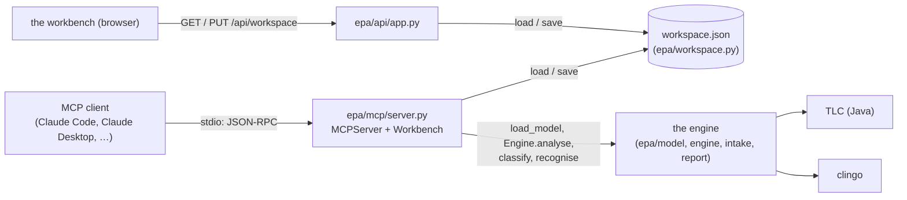
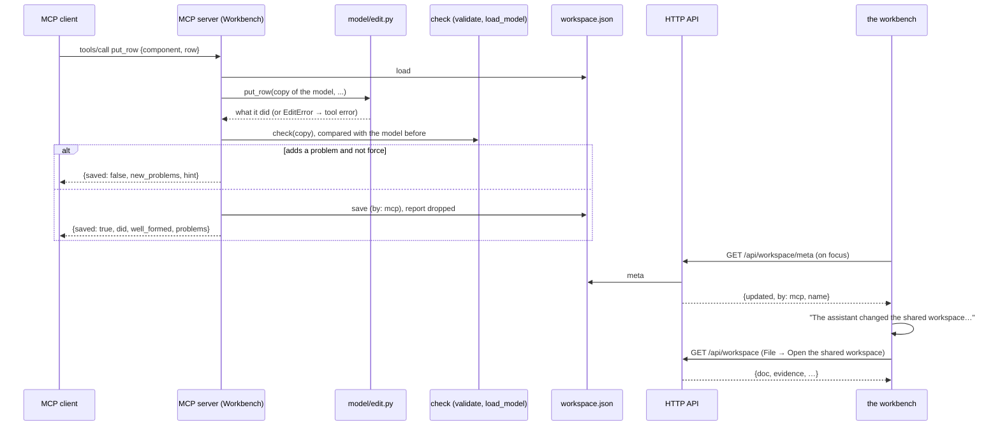
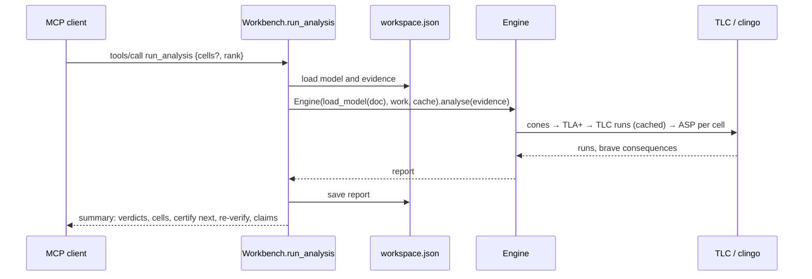

# The MCP server, the shared workspace and model edits

Part of the [developer guide](../developer-guide.md). Files: `epa/mcp/server.py`, `epa/workspace.py`,
`epa/model/edit.py`, `mcp.sh`, `.mcp.json`; the workbench side is in `epa/api/app.py`
(`/api/workspace`) and `web/app.js` (`openWorkspace`, `saveWorkspace`, `watchWorkspace`).

## 1. What it is for

The MCP server lets an assistant (Claude Code, Claude Desktop, or any client of the Model Context
Protocol) do what an analyst does in the workbench: open a demo case, build or change a model, add
evidence, run the analysis and read the verdicts. It speaks MCP over stdio, built on the official
Python SDK (`mcp` 2.x, `MCPServer`).

It works on the **shared workspace**: one model and its evidence in a JSON file in the work folder
(`.epa-work/workspace.json` by default, next to the run cache), saved after every change. The
workbench in the browser can open that file (File → Open the shared workspace) and save its own model
into it (File → Save to the shared workspace…), and it says when the assistant has changed it. So an
assistant and a person can take turns on one model.



## 2. Running it

```sh
./mcp.sh                                   # the project's .venv; installs the requirements if needed
python -m epa mcp [--workspace FILE] [--work DIR]
```

`mcp.sh` changes to the repository, so a client may start it from any folder; everything except the
protocol goes to stderr. `.mcp.json` registers it for Claude Code in this repository. For other clients,
point them at the absolute path of `mcp.sh` (see the user guide).

## 3. The tools

Every tool returns a JSON object (structured content). A tool that cannot do what was asked raises a
tool error whose message says why and what to do instead (an unknown case, no model yet, a malformed
witness). Read-only tools are annotated `readOnlyHint`; removals `destructiveHint`.

| group | tools |
|---|---|
| workspace and models | `workspace_status`, `list_cases`, `open_case`, `new_model`, `import_model`, `export_model`, `get_model`, `check_model`, `list_rows` |
| model edits (each checked) | `put_component`, `remove_component`, `connect`, `remove_edge`, `put_row`, `remove_row`, `set_absorbs`, `drop_default`, `restore_default`, `put_guard`, `remove_guard`, `put_observation_point`, `remove_observation_point`, `put_use_case`, `remove_use_case`, `put_claim`, `remove_claim`, `set_model_settings` |
| evidence | `list_evidence`, `add_certificate`, `add_witness`, `ingest_log`, `add_recogniser`, `set_deployments`, `withdraw_certificate`, `reject_witness`, `remove_evidence` |
| analysis | `run_analysis`, `get_verdict`, `explain_cell`, `export_report` |

Resources: `epa://docs/model-format` (the model format, so a client can write models),
`epa://docs/user-guide`, `epa://workspace/model.yaml` (the current model).

**Every edit is checked.** `Workbench._edit` applies the edit to a copy of the model, runs the model
check (`validate` and `load_model`; anything the loader cannot read counts as a problem), and saves the
copy only if it adds no problem. Otherwise it answers `{saved: false, new_problems, hint}`; the same
call with `force=true` saves it anyway (as *Save anyway* in the workbench). An edit also drops the last
analysis report, which no longer matches the model.

## 4. Definitions

### epa/mcp/server.py

| Definition | What it does |
|---|---|
| `INSTRUCTIONS` | The server's instructions to the client: the vocabulary and the typical order of calls. |
| `ToolError` | A refusal with a message; turned into an MCP tool error by `build_server`. |
| `check(doc)` | The model check: `validate` on a copy, then `load_model`; any exception from the loader is reported as a problem. Returns `{ok, problems, model}`. |
| `_strip(x)` | A certificate or witness without the register's classification fields. |
| `Workbench` | The logic behind the tools, returning plain dicts (tested without a client). Holds the workspace path, the work folder and one `RunCache`. |
| `Workbench.ws`, `Workbench.save` | Load and save the workspace (`by: mcp`). |
| `Workbench._doc`, `Workbench._model` | The workspace model, or a `ToolError` if there is none; the loaded `Model`, or a `ToolError` listing its problems. |
| `Workbench.status` | `workspace_status`: the model's counts, problems, evidence counts, case and stage, the last verdict counts. |
| `Workbench._edit(fn, force)` | Applies one edit function from `epa/model/edit.py` to a copy, checks it, saves it unless it adds problems (section 3). |
| `Workbench.list_cases`, `Workbench.open_case` | The demo cases with their stages; load a case at a stage: model, evidence (`stage_inputs`), recognisers, deployment manifest and lookup files, as the browser's bundle does. |
| `Workbench.new_model`, `Workbench.import_model`, `Workbench.export_model`, `Workbench.get_model` | Start a blank model; read one from text or a file; write it as YAML; read it as a summary, YAML or JSON. |
| `Workbench.check_model`, `Workbench.list_rows` | The problems, or the cells with their open rows and candidate counts; the analyst's rows and the engine's generated rows. |
| `Workbench.list_evidence` | The register (`Engine.register`): every certificate and witness with its state and reason. |
| `Workbench.add_certificate`, `Workbench.add_witness` | Classify and add (`cert_import.classify`; `log_import.manual_witness` and `classify_witness`). |
| `Workbench.ingest_log`, `Workbench.add_recogniser`, `Workbench.set_deployments` | Read a log with the workspace's recognisers (a path may be relative to the open case's folder); add a recogniser; set the manifest. |
| `Workbench.withdraw_certificate`, `Workbench.reject_witness`, `Workbench.remove_evidence` | Record a decision (a rejection needs a second reviewer); take an item out altogether. |
| `Workbench.run_analysis` | `Engine(m, work, cache).analyse(...)` on the workspace; stores the report in the workspace and returns `_summary`. |
| `Workbench._report`, `Workbench.get_verdict`, `Workbench.explain_cell`, `Workbench.export_report` | The stored report (or a `ToolError` asking for `run_analysis`); one cell in full; a reaching run (`Engine.trace_of`, `explain.trace_story`) and optionally the candidates (`Engine.possibilities`); the Markdown report or the CRA export. |
| `Workbench.put_component` … `Workbench.set_model_settings` | One method per edit tool, each `_edit` around the function of the same name in `epa/model/edit.py`. |
| `_verdict_counts`, `_short_reason`, `_summary` | The run summary: verdict counts, per cell the verdict, statuses, a short reason, conflicts and advice, what to certify next, re-verification, claims. |
| `build_server(bench)` | Registers the tools and resources with `MCPServer` (annotations, docstrings as descriptions); `ToolError` becomes the SDK's tool error so the message reaches the client. |
| `main(argv)` | `python -m epa.mcp.server` argument parsing; `epa/cli.py` has the same as `python -m epa mcp`. |

### epa/workspace.py

| Definition | What it does |
|---|---|
| `default_path(work)` | `<work>/workspace.json`, the work folder being `EPA_WORK` or `.epa-work`. |
| `empty_evidence()`, `blank()` | The empty evidence register (certificates, witnesses, decisions, recognisers, deployments, lookups, files); an empty workspace. |
| `load(path)` | The workspace, or a blank one if the file does not exist. |
| `save(path, ws, by)` | Writes atomically (a temporary file and a rename) with a time stamp and who wrote it (`mcp` or `browser`). |
| `meta(path)` | When and by whom the workspace was last written, and the model's name, without the model. |

### epa/model/edit.py

Edits of a model document in place, mirroring what the workbench does in `web/state.js` and
`web/modeldialogs.js`. They refuse what can never be right with `EditError` (an unknown component, a
duplicate id, wiring two system ports); everything else is left to the model check that runs after
them.

| Definition | What it does |
|---|---|
| `EditError` | An edit that cannot apply. |
| `ensure_lists(doc)` | Fills the missing lists of a document. |
| `component(doc, cid)`, `_edge(doc, eid)`, `ids_in_use(doc)`, `fresh(base, taken)`, `top_modes(doc)`, `sys_ports(doc)`, `_split(ref)` | Look-ups and helpers: a component or an edge (or an `EditError` listing what exists), the ids of components and guards, a fresh identifier, the top-level modes, the system inputs and outputs, `"comp.port"` → `(comp, port)`. |
| `put_component(doc, spec)` | Creates a component (needs a kind) or changes the fields given; `inputs`/`outputs` add ports; `new_id` renames it (`rename_component`). |
| `rename_component(doc, old, new)` | Renames a component and the edges that name it. |
| `remove_component(doc, cid)`, `_drop_edges(doc, ids)` | Removes a component, its edges, and the guards and points on them. |
| `connect(doc, source, target, label, edge_id)` | Adds an edge, creating the ports it names; as in the workbench, the first wire out of a system input creates the use case `uc1`. |
| `remove_edge(doc, eid)` | Removes an edge with its guards and point. |
| `put_row(doc, cid, row, replace)`, `remove_row(doc, cid, rid)` | Adds a row, or replaces one by id (row ids are unique in the model). |
| `set_absorbs`, `drop_default`, `restore_default` | What stops at an input (with the reason); an LLM default dropped (with the reason) or restored. |
| `put_guard(doc, spec)`, `remove_guard(doc, gid)` | A new guard on an edge, or the fields given changed (rename with `new_id`). |
| `put_observation_point(doc, spec)`, `remove_observation_point(doc, oid)` | A new point on an edge (judging every top-level mode at 1 unless told; one per edge), or the fields given changed (rename with `new_id`; claims follow). |
| `put_use_case`, `remove_use_case`, `put_claim`, `remove_claim`, `set_settings` | Use cases, claims, and the name, description, modes and levels. |
| `blank(name, description)` | A new, empty model (as File → New model). |

## 5. Sequence: an assistant changes the model, the analyst sees it



## 6. Sequence: run_analysis



## 7. How it is tested (`tests/test_mcp.py`)

* the edit functions build a model the engine loads, and refuse impossible edits;
* `Workbench` refuses an edit that adds a problem, catches a shape the loader cannot read, saves with
  `force`, classifies evidence, ingests a case log and analyses (the wallet incident suspends `c_gm`);
* a real MCP session over stdio with the SDK's client: list the tools, open wallet S2, run the
  analysis (oom at the bank statement is a hope with the conflict `{c_gm}`, as `tests/test_cases.py`
  expects of the engine), read a verdict, get a tool error with its message, read a resource;
* the same server in raw JSON-RPC, with no SDK on the client side (initialize, tools/list,
  tools/call, an error);
* the workspace endpoints of the HTTP API: the browser sees what the assistant built, and the
  assistant sees what the browser saved.
