# Bimodal Agentic System Reasoner: developer guide

How the reasoner is built: its parts, how they call each other, what happens in each workflow, and
where every file and function is described. For using the reasoner see the
[user guide](user-guide.md); for the model document see [model-format.md](model-format.md).

**Reference pages** (every file, class and function, with what it does and what it calls):

| page | covers |
|---|---|
| [dev/model.md](dev/model.md) | `epa/model/`: loading and checking a model, generated rows, cells and cones |
| [dev/alethic.md](dev/alethic.md) | `epa/translate/`, `epa/alethic/`: the TLA+ module of a cone, running TLC, reading runs |
| [dev/engine.md](dev/engine.md) | `epa/epistemic/`, `epa/engine/`: the ASP encoding, the coordinator, the run cache, case scenarios |
| [dev/intake-api.md](dev/intake-api.md) | `epa/intake/`, `epa/report/`, `epa/cli.py`, `epa/api/app.py`: evidence, reports, the CLI, the HTTP API |
| [dev/web.md](dev/web.md) | `web/`: the browser UI, its state, events, dialogs and views |
| [dev/mcp.md](dev/mcp.md) | `epa/mcp/`, `epa/workspace.py`, `epa/model/edit.py`: the MCP server and the shared workspace |
| [dev/call-graph.md](dev/call-graph.md) | generated: every call between the Python functions, the module dependencies, the browser's imports |

`python tools/inventory.py` lists every definition with its current line number; `--md` regenerates
the call graph; `tests/test_docs.py` fails when a function is not described or the call graph is stale.

---

## 1. System architecture

The reasoner is a Python engine with three front doors: a browser UI served by a FastAPI app, a
command line, and an MCP server. The engine calls two external solvers: **TLC** (the TLA+ model
checker, Java) explores runs, and **clingo** (answer set programming, a Python module) reasons over
them.

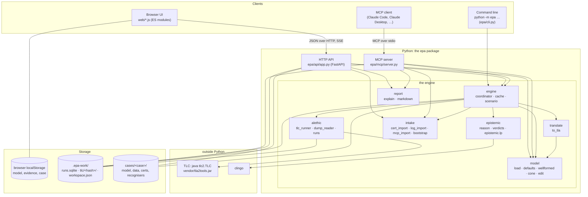

* **The browser holds the model and the evidence** (`S.doc`, `S.evidence` in `web/state.js`, saved in
  `localStorage`). The server is mostly stateless: every request carries the model it is about. The
  exceptions are running analyses (kept in memory by `epa/api/app.py`), the run cache and TLC files
  (`.epa-work/`), and the shared workspace (`.epa-work/workspace.json`).
* **The engine is plain Python** with no web dependency; the API, the CLI and the MCP server all call
  the same functions (`load_model`, `Engine.analyse`, `cert_import.classify`, `log_import.recognise_all`,
  `markdown.report`, …).
* **Caching** has two levels: the SQLite run cache (`engine/cache.py`, keyed by a cone's behaviour hash
  and the firing choices already explored) and TLC's work folders (`tlc/<hash>/`, keyed by the module
  text). A second analysis of an unchanged model starts no Java process.

## 2. The pipeline: from a model to verdicts

```mermaid
flowchart LR
  D["model document<br/>(YAML / JSON)"] -->|"load_model<br/>validate · normalise<br/>defaults · wellformed"| M["Model<br/>components, edge segments,<br/>rows (analyst + generated)"]
  M -->|"cone.cells"| C["cells<br/>mode@point"]
  C -->|"cone.cones<br/>(path-sensitive, merged per point)"| K["cones<br/>open rows, edges, use cases"]
  K -->|"to_tla.module_for"| T["TLA+ module<br/>Init: use case × switch vector<br/>Next: one ready component fires"]
  T -->|"tlc_runner.run<br/>(java TLC, -dump states)"| S["state dump"]
  S -->|"runs.runs_from_dump"| R["runs<br/>(uc, switch vector, outcome) → labels"]
  EV["evidence<br/>certificates, witnesses,<br/>decisions"] -->|"Engine.register<br/>classify"| REG["register<br/>in force / rejected / stale / withdrawn"]
  R -->|"Engine.problem"| P["CellProblem<br/>facts + epistemic.lp"]
  REG --> P
  P -->|"clingo: brave reasoning,<br/>minimal conflicts"| V["verdict per cell<br/>guarantee · hope · exposed ·<br/>unchecked · not exercised · conflict"]
  V --> O["report<br/>reasons, candidates, root causes,<br/>example run, certify-next ranking,<br/>claims, re-verify"]
```

1. **Model** ([dev/model.md](dev/model.md)). `load_model` reads the document, checks it (`validate`),
   builds the `Model` (`normalise`: guards become components that cut their edge into segments,
   observation points sit on the last segment), adds the generated rows (`defaults`: LLM worst-case
   defaults, guard leak and false-positive rows) and checks it again (`wellformed`).
2. **Relevance** ([dev/model.md](dev/model.md)). Every observation point and judged failure is a
   *cell*. Its *cone* is the set of rows, edges and fields that can change it, found backwards from the
   point per `(edge, field)`; cones of one point are merged so one TLC run serves several cells.
3. **Runs, the alethic layer** ([dev/alethic.md](dev/alethic.md)). A cone becomes a TLA+ module whose
   initial states are every use case × every switch vector of the cone's open rows, and whose steps fire
   one ready component each: TLC branches on which, so it walks every firing order. A run ends when no
   component is ready; the terminal states, one per distinct outcome, are the runs.
4. **Candidates, the epistemic layer** ([dev/engine.md](dev/engine.md)). A candidate gives each open row
   an activation (never, sometimes, always). clingo keeps the candidates the evidence allows:
   certificates fix rows, witnesses need a matching run, the LLM rule forbids "never" on LLM rows. The
   statuses the remaining candidates give the failure are the verdict.
5. **Report** ([dev/engine.md](dev/engine.md), [dev/intake-api.md](dev/intake-api.md)). Reasons (what
   a verdict rests on), candidate counts, root causes, an example run, conflicts and suspended
   certificates, the certify-next ranking, claims, re-verification; as JSON, Markdown or the CRA export.

## 3. How the functions call each other

The full, generated graph is in [dev/call-graph.md](dev/call-graph.md). These are the main paths.

### 3.1 Loading a model

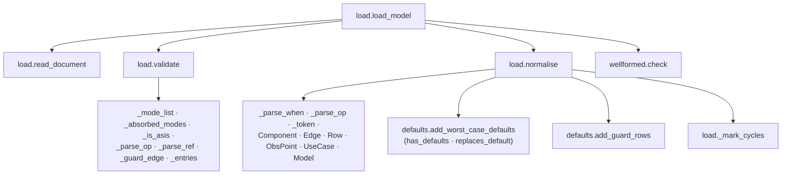

### 3.2 One analysis

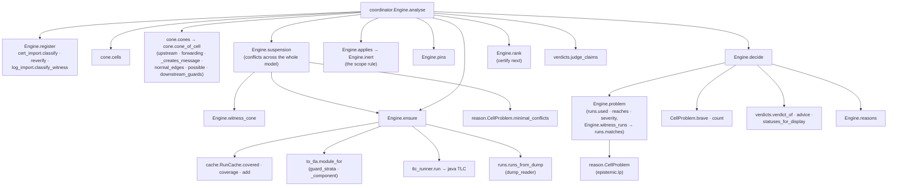

### 3.3 The browser

The views never call each other; they share `S` and an event bus (`on`, `emit` in `web/state.js`). The
import graph is in [dev/call-graph.md](dev/call-graph.md).

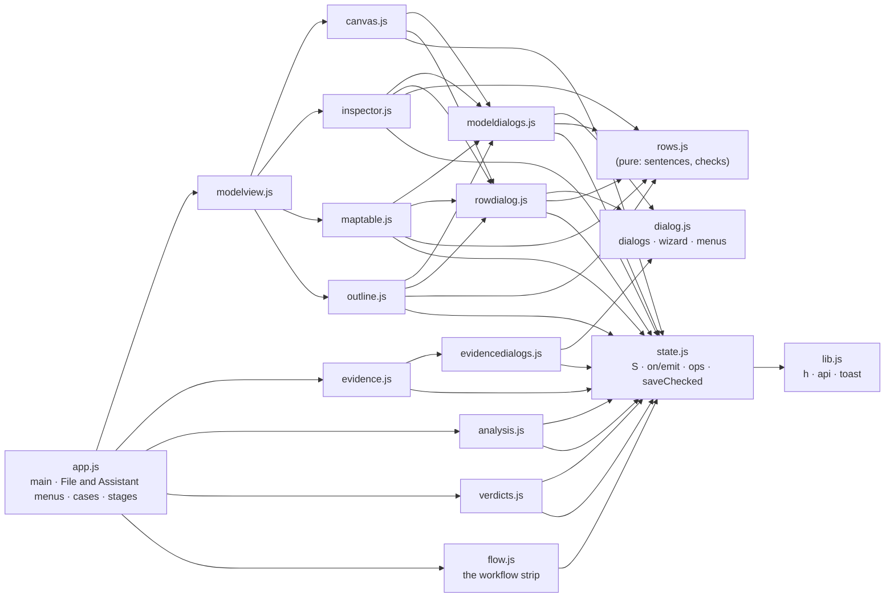

## 4. Workflows

### 4.1 Editing the model in the reasoner

Direct edits on the canvas (drag, wire, delete) change `S.doc` and call `changed()`. Everything opened
by *Edit…*, *Add row…* or a drop of a guard or an eye goes through a dialog that edits a copy:

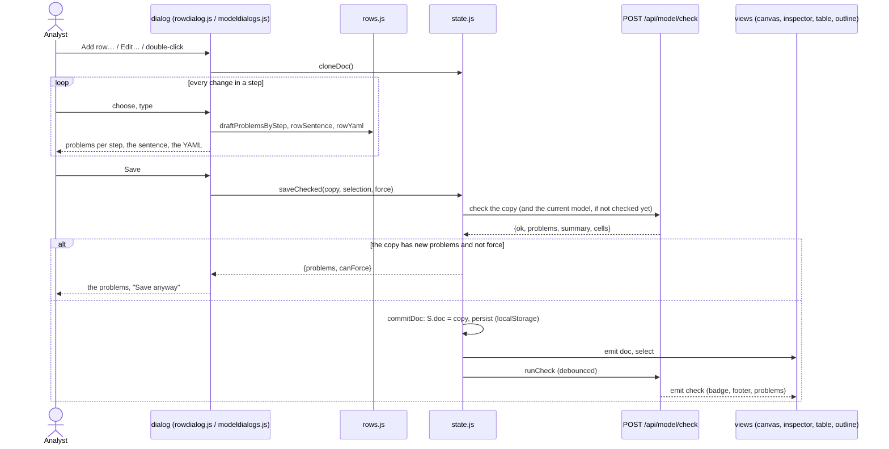

### 4.2 Opening a demo case and a stage

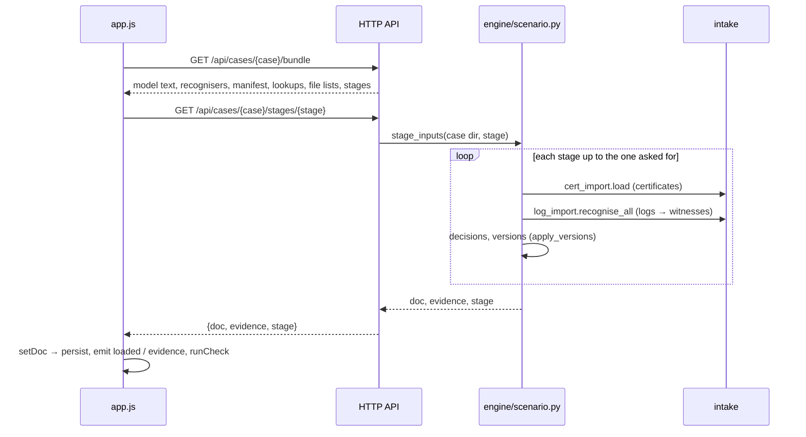

### 4.3 Adding evidence

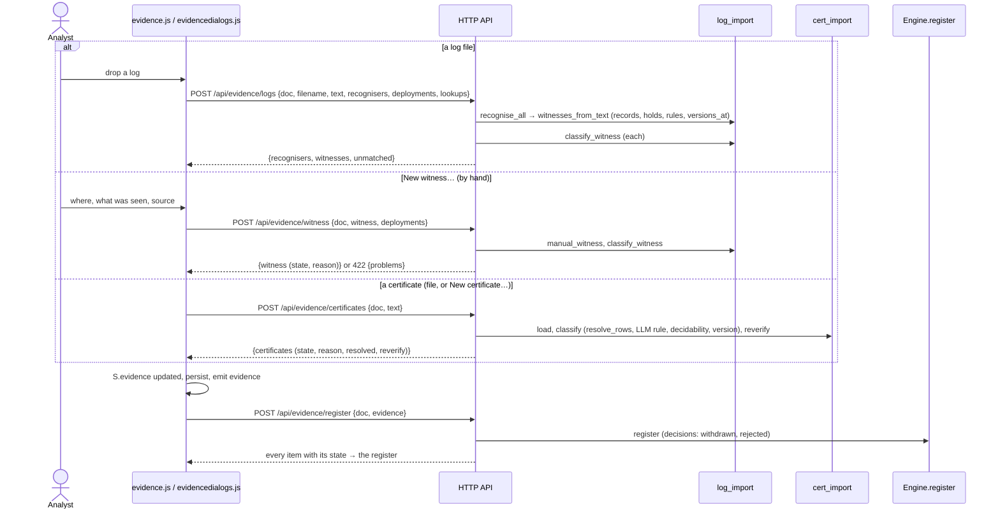

### 4.4 Running an analysis

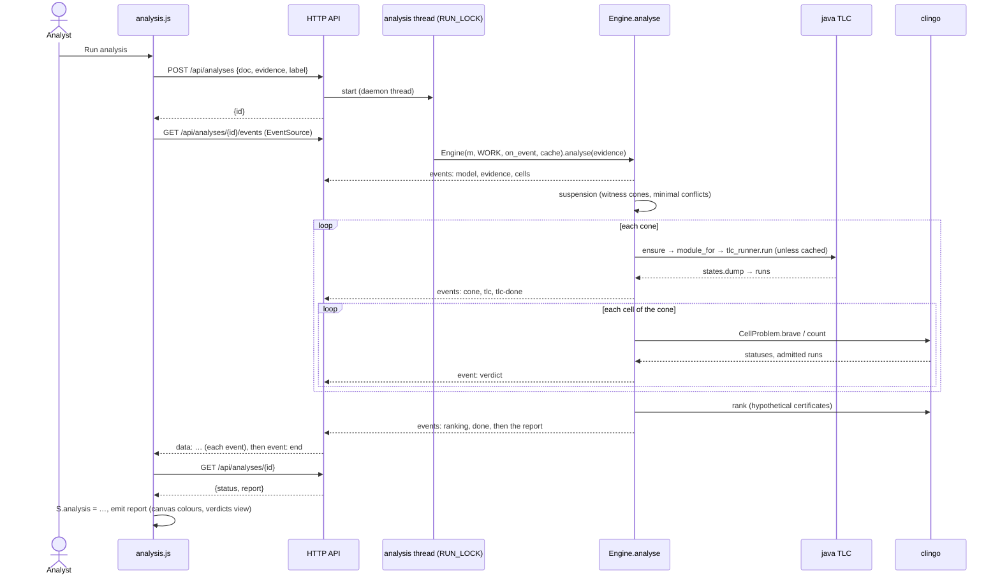

### 4.5 Looking into a verdict

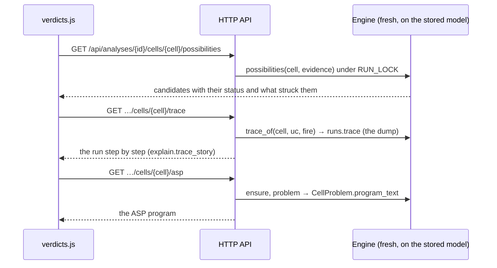

### 4.6 The runs of one cone

See the sequence diagram in [dev/alethic.md](dev/alethic.md#6-workflow-the-coordinator-asks-for-the-runs-of-a-cone):
the run cache is asked first, then `to_tla.module_for`, `tlc_runner.run` (answered from disk when the
module was run before), `runs.runs_from_dump`, and the cache stores the runs.

### 4.7 An assistant through the MCP server

See [dev/mcp.md](dev/mcp.md#5-sequence-an-assistant-changes-the-model-the-analyst-sees-it): every
tool call loads the shared workspace, edits a copy with `epa/model/edit.py`, checks it, and saves it
unless it adds problems; the reasoner notices the change and opens it on request.

### 4.8 Bootstrapping a model from traces

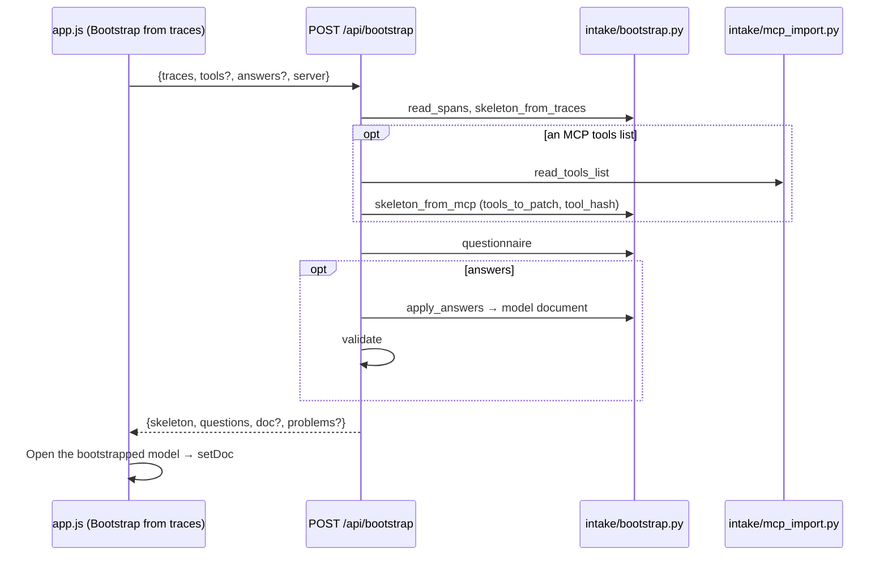

## 5. The data that flows

| data | shape | described in |
|---|---|---|
| model document | YAML/JSON: modes, lattices, components (ports, flow, rows, absorbs, drop_defaults), guards, edges, use cases, observation points, claims | [model-format.md](model-format.md) |
| `Model` | normalised dataclasses: components (guards included), edge segments, rows (analyst and generated), points, use cases | [dev/model.md](dev/model.md#3-dataclasses) |
| certificate | `{id, component, targets \| rows, version, issuer, date, method, scope, context}` | [dev/intake-api.md](dev/intake-api.md#4-certificates) |
| witness | `{id, use_case, at: {point: {modes: {f: [lo, hi]}, taint, conf, auth, used}}, date, source, recogniser, versions, rule, lines}` | [dev/intake-api.md](dev/intake-api.md#3-recognisers) |
| decision | `{kind: withdraw-cert, certificate, by, reason}` or `{kind: reject-witness, witness, by, second_reviewer, reason}` | [dev/engine.md](dev/engine.md) |
| run | `(uc, switch vector, variant) → labels {u, n, k: {b, c, a, t}}` per edge | [dev/alethic.md](dev/alethic.md#5-reading-runs-and-why-the-reductions-are-sound) |
| report | `{model, register, cells, suspension, cones, tlc_calls, absorbed, reverify, claims, engine, ranking, log, seconds}` | [dev/engine.md](dev/engine.md#shape-of-the-returned-report) |
| events | `{t, step, msg, …}`: model, evidence, cells, cone, tlc, tlc-done, conflict, verdict, ranking, done | [dev/engine.md](dev/engine.md#events-emitted-through-emit) |

## 6. State and storage

| where | what | lifetime |
|---|---|---|
| browser `localStorage` | `epa.doc`, `epa.evidence`, `epa.case` (and small UI preferences) | until the browser's site data is cleared |
| server memory (`ANALYSES` in `api/app.py`) | running and finished analyses, their events and reports | until the server restarts |
| `.epa-work/runs.sqlite` | the run cache: runs and the switch vectors covered, per cone | kept; safe to delete |
| `.epa-work/tlc/<hash>/` | each generated module, its cfg, TLC's output and state dump | kept; safe to delete |
| `.epa-work/workspace.json` | the shared workspace of the MCP server and the reasoner | kept |

`EPA_WORK` moves the work folder; `EPA_WORKSPACE` moves the workspace file for the HTTP API.

## 7. Testing

```sh
.venv/bin/python -m pytest -q          # everything, about two minutes (TLC runs are cached in a temporary folder)
```

| tests | what they check |
|---|---|
| `tests/test_engine.py`, `test_draft4.py`, `test_ports.py` | the engine against the paper's definitions and examples |
| `tests/test_differential.py` (with `tests/reference/`) | the cone reduction against an independent whole-model reference semantics, on random models |
| `tests/test_cases.py` | every stage of the three demo cases gives the expected verdicts |
| `tests/test_api.py`, `tests/test_manual_evidence.py` | the HTTP API; witnesses and certificates written by hand |
| `tests/test_web.py` (runs `web/tests/*.test.js` under node) | the browser's row logic against every row of the shipped models (skipped without node) |
| `tests/test_mcp.py` | the model edits, the MCP server through a real client and in raw JSON-RPC, the shared workspace |
| `tests/test_tutorial.py`, `tests/test_tour_browser.py` (runs `tests/browser/tour_paths.mjs` in headless Chrome) | the tour's story with the engine; the tour off the happy path: skips, Do it for me clicked through, windows left open, another model opened, parts deleted (skipped without Chrome or Node 22+; `EPA_TOUR_FULL=1` skips to every step) |
| `tests/test_docs.py` | every definition is described in `docs/dev/`, the call graph is current, links resolve |

`bench/bench.py` measures how analysis time grows with open rows and use cases.

## 8. Extending

* **A new model concept** (a field of a component, a new kind of row): `validate` (raw rules) →
  `normalise` (the `Model`) → `wellformed.check` → `cone.cone_of_cell` (relevance) → `to_tla._component`
  (semantics) → `tests/reference/semantics.py` (the independent semantics, so the differential test
  covers it) → `docs/model-format.md` → the dialog that edits it (`web/modeldialogs.js` or
  `web/rows.js` + `web/rowdialog.js`) → `epa/model/edit.py` and the MCP tool if assistants should set it.
* **An HTTP endpoint**: a function in `epa/api/app.py` with a pydantic body; keep the engine call in
  the engine packages; add a test in `tests/test_api.py`.
* **A dialog**: `wizard({...})` from `web/dialog.js` with steps that report `problems`, editing a copy
  from `cloneDoc()` and saving with `saveChecked` (see `openEdgeDialog` for the smallest example).
* **An MCP tool**: a method on `Workbench` (returning a dict, raising `ToolError` for refusals; edits go
  through `_edit`) and a registration in `build_server` with a docstring the client reads; add it to
  `tests/test_mcp.py`.
* After a change: `python tools/inventory.py --md > docs/dev/call-graph.md` and describe new functions
  in the reference page of their package (`tests/test_docs.py` says which).

## 9. Known issues

Found while writing these pages; each is described where it lives. None changes a verdict of the
demo cases, but they are worth fixing:

* **Inputs that crash the loader instead of giving a problem** (the API's model check answers HTTP 500):
  `const` without a number, a guard target with no kind, an unknown level in a use-case token, an odd
  `when` pattern, an observation point without an id ([dev/model.md](dev/model.md#6-observations)).
  The reasoner's dialogs do not produce these; the MCP server reports them as problems.
* **Ids not checked for uniqueness** for rows, observation points and use cases; **leak row ids
  collide** when one guard has two targets of the same kind ([dev/model.md](dev/model.md#6-observations)).
* **`fp_omission: 0`** on a learned guard means 10 in its row but 0 in the TLA+
  ([dev/model.md](dev/model.md#6-observations)).
* **The TLC disk cache key** leaves out the TLC version, so upgrading `vendor/tla2tools.jar` reuses
  old dumps ([dev/alethic.md](dev/alethic.md#7-observations)).
* **Unused code**: `cone.exact_points`, `runs.witness_fields_for_cell`, the `schedule` argument, and
  others listed in the observations of each page.
* **Analyses are kept in memory** by the server, never pruned, and lost on restart
  ([dev/intake-api.md](dev/intake-api.md)).
