# EPA workbench: user guide

The EPA workbench answers one question about an agentic system (LLM components, tools, guards,
logs): **for each place where you can read a log, and each kind of failure, what does the evidence
you have still leave possible?** You draw the system, add what you know (certificates from the
teams, witnesses from the logs), run the analysis, and read one verdict per observation point and
failure, with the reasons and what to certify next.

| verdict | what it means for you |
|---|---|
| **guarantee** | in every possibility the evidence leaves, the failure never reaches this point |
| **hope** | it reaches the point sometimes: an LLM decides, and no evidence can make that "never" |
| **exposed** | it reaches the point whenever the point is used: a design problem |
| **unchecked** | the possibilities disagree; the evidence has not settled it (the advice says what would) |
| **not exercised** | no use case sends a message over this point |
| **conflict** | the evidence contradicts itself; the engine names the smallest conflicting sets |

This guide follows the four steps of the workbench: **Model → Evidence → Analysis → Verdicts**.
The format of the model file is in [model-format.md](model-format.md); how the code works is in
[developer-guide.md](developer-guide.md).

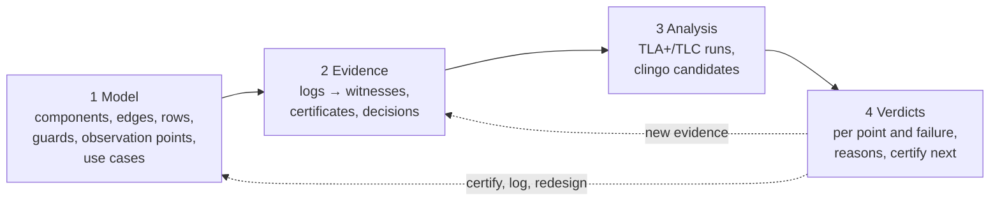

---

## 1. Starting the workbench

You need Python 3.10 or newer and Java 11 or newer (TLC, the TLA+ model checker, runs on Java; its
jar ships in `vendor/`).

```sh
./run.sh            # makes .venv, installs the requirements, starts http://127.0.0.1:8765 and opens it
./run.sh 9000       # another port
```

`GET /api/health` (open `http://127.0.0.1:8765/api/health`) says whether Java, the TLC jar and
clingo were found. Without Java the workbench still opens, but analyses whose runs are not cached
fail.

The workbench keeps your model and evidence in the browser (local storage), so a reload brings back
where you were. To keep a model, export it (**File → Export the model as YAML**).

## 2. The screen

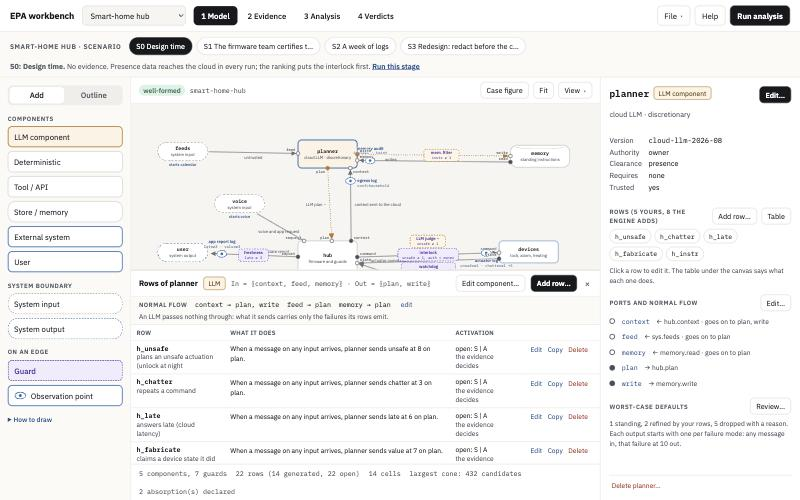

* **Top bar**: the demo case picker, the four steps (**1 Model**, **2 Evidence**, **3 Analysis**,
  **4 Verdicts**), the **File** menu (new, import, export, bootstrap), **Help**, and **Run analysis**.
  A dot on *4 Verdicts* means there are new verdicts you have not looked at.
* **Scenario bar** (only for a demo case): the stages of the case's story. Clicking a stage loads
  the model and the evidence as they were at that point; *Run this stage* runs the analysis.
* **Left pane**: **Add** (the palette you drag from) or **Outline** (everything in the model as
  lists; see 3.9).
* **Canvas**: the system. The badge over it says *well-formed* or how many problems the model has;
  the footer counts components, rows and cells. **View** chooses what the canvas shows; **Fit**
  brings the whole model into view.
* **Rows table** under the canvas: the rows of the selected component or guard (sections 3.3 and 3.4).
* **Inspector** on the right: what the selected thing is, in words, with **Edit…**. With nothing
  selected it shows the model itself: its failure modes, levels, use cases and claims.

### Mouse and keyboard

| action | how |
|---|---|
| select | click it (or click it in the Outline) |
| edit | **Edit…** in the inspector, a double-click on the canvas, or **Enter** |
| delete | **Delete** or **Backspace** on the canvas (it asks first), or *Delete …* at the bottom of the inspector |
| pan · zoom | drag the background · scroll |
| close a window | **Escape** or ×; a window with unsaved changes asks before throwing them away |

## 3. Modelling

### 3.1 Starting a model

* **Open a demo case** from the case picker: a smart-home hub, a delegated wallet agent and an MCP
  coding agent, each with its architecture figure (**Case figure**), mock logs and certificates.
* **File → New model…** starts a blank canvas (export the current model first if you want it).
* **File → Import a model…** reads a YAML or JSON model (the format of `cases/*/model.yaml`).
* **File → Bootstrap from traces…** drafts a model from OpenTelemetry-style spans and an MCP
  `tools/list`; an answers file fills in what traces cannot know (which checks are guards, what each
  observation point tolerates). See section 3.11.

### 3.2 Components, system ports and edges

Drag from **Add** onto the canvas:

| item | what it is |
|---|---|
| LLM component | discretionary: decides by itself. It passes nothing through; it starts with worst-case rows |
| Deterministic, Tool / API, Store / memory | code: every failure passes through unless you say it is absorbed |
| External system, User | outside your control; untrusted by default (they taint what they touch) |
| System input / System output | where messages enter and leave the system |

**Wiring.** A component has *ports*: inputs are hollow dots, outputs filled. Drag from an output
port onto an input port, or onto a component (it gets a new input port). The **+** handle that
appears on a hovered component starts a new output port. An edge always runs from an output (or a
system input) to an input (or a system output).

**Editing a component**: select it and press **Edit…**. The window has five tabs:

* **Properties**: id, kind, label, version (certificates and witnesses name versions; a change makes
  the old ones stale), own authority, clearance (the most confidential data it may receive), the
  authority it requires, whether it is trusted and whether it acts on its own authority.
* **Ports**: add, rename (edges and rows follow) and delete ports.
* **Normal flow**: for each input, which outputs a message goes on to on the happy path.
* **What it absorbs** (not for an LLM): tick a failure at an input to say it stops there, and give
  the reason. Every failure passes through unless you say otherwise; an absorption is a claim, and
  its reason is printed wherever a verdict rests on it.
* **LLM defaults** (only for an LLM): see 3.5.

### 3.3 Rows: what a component does with failures

A component's **rows** say which failure arriving where makes it send which failure where, which
failure it starts on its own, or where it forwards a message. They are listed in the rows table
under the canvas, one sentence each:

> When late ≥ 3 on view arrives, agent sends dup at 9 on request.

**Adding a row.** Select the component and press **Add row…** (in the table or the inspector). A
window walks you through four steps; the sentence at the bottom always says what the row will do,
and *As YAML* shows the exact text that goes into the model.

| step | what you choose |
|---|---|
| **Kind** | *Failure row* (a condition and a failure sent on), *Internal fault* (a failure started with no message arriving), *Forwarding* (a message goes on to other outputs as it is), *Sink* (a failure that arrives may be absorbed). Kinds that cannot apply are greyed out with the reason (an LLM has no sinks). |
| **When** | the conditions, all of which must hold: an input port (or *any input*) and *any message* or *a failure of at least* a magnitude (1–10). |
| **Then** | the emissions: an output port, the failure sent, and how strong: *at a fixed magnitude* (0–10), *at the matched magnitude*, *at the matched magnitude + k*, or *at the largest matched magnitude*. The last three need a failure in the condition. *The message as it is* sends it on unchanged. |
| **Name and activation** | the row's id and a description, and the activation: **Open** (the evidence decides: never, sometimes or always) or fixed **Always**, **Sometimes**, **Never**. An LLM row that sends a failure can never be *Never* (the LLM rule). |

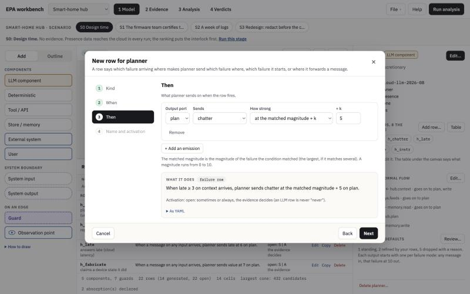

The window will not let you go on while a step has something to fix; the step names on the left
show how many things are left in each. **Add row** asks the server to check the whole model with
the row in it; if the row would create new problems, the window lists them and offers *Save anyway*.

**Editing a row**: click *Edit* in its line (or double-click the line, or click the row's chip in
the inspector). The same window opens with the steps as tabs, so you can jump straight to the part
you want; **Save row** is always there. *Copy* opens a new row prefilled from this one; *Delete*
asks first and tells you if a certificate names the row.

Leave a row **Open** unless the model fixes it on purpose: the analysis then keeps every activation
as a possibility and lets the evidence choose.

### 3.4 The rows the engine adds

Folded under *Rows the engine adds* in the table:

* **pass-through** (non-LLM components): every failure arriving on an input goes on where that input
  is forwarded. *Absorb…* says that some of them stop there, with a reason.
* **worst-case defaults** (LLM components): for every output and every failure mode, "on any
  message, the LLM sends that failure at 10". *Refine…* opens the row window prefilled with the same
  trigger, to say more precisely what the LLM sends (a lower magnitude, for example); *Drop…*
  removes the default and asks for the structural reason; *Restore* brings it back.
* **absorptions**: what you declared absorbed, with the reason. *Edit…* changes it.

For a guard the table shows its fixed behaviour (what catching does), one **leak row** per target
("the target gets through", whose activation is the guard's quality) and, for a learned guard, a
**false-positive row**.

### 3.5 LLM defaults

An LLM component starts with the worst case: on any message it may send any failure at magnitude
10 on every output. You refine this with rows (3.3): a row with the same trigger (any input, any
message) that sends the same failure on the same port replaces the default; any other row is added
beside it. In **Edit… → LLM defaults** you see every default with its state (standing, replaced by
your row, dropped) and can drop one with a reason.

### 3.6 Guards

Drag **Guard** from Add onto an edge. A window asks what the guard is and what it catches:

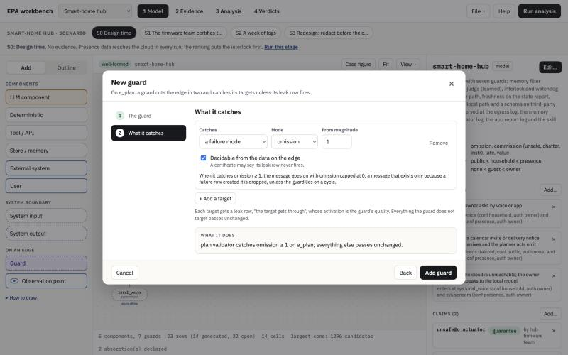

* **The guard**: a name, an id (certificates name it), a version, the edge it cuts, whether it is
  **learned** (a classifier or an LLM judge: no certificate can say it never leaks; it also gets a
  false-positive row) and whether it has a **closed output** (it only emits enumerations, so it may
  wash taint). With several guards on one edge, *Earlier* and *Later* set the order they cut it.
* **What it catches**: one or more targets: a failure mode from a magnitude, taint, confidentiality
  above a level, or authority below a level. Tick **decidable from the data on the edge** when a
  certificate could truthfully say the guard never lets it through.

Cancel leaves the model as it was. Edit a guard later with **Edit…** or a double-click on it.

### 3.7 Observation points

Drag **Observation point** (the eye) onto the edge whose log you can read. It judges what the
receiver gets, after every guard on the edge. In its window:

* **The point**: name, id (witnesses and verdicts name it), the edge, and where the log comes from.
* **Failures it judges**: tick each failure mode it judges and the magnitude from which it counts
  (1 accepts none). Every ticked mode is a *cell* of the verdict table.
* **Provenance**: whether it flags tainted messages, and the confidentiality above which, or the
  authority below which, a message counts as reaching it (against the receiver's own clearance and
  required authority, or a level you name).

### 3.8 Use cases, claims and the model's settings

With nothing selected, the inspector shows the model.

* **Use cases** (*Add…*): where messages enter and what they already carry: tainted (text from
  outside), a confidentiality, an authority, failures they bring along. Selecting a system input
  also lists the use cases that start there.
* **Claims** (*Add…*): what someone says a cell's verdict is ("the wallet team claims guarantee for
  oom at the bank statement"). The verdicts say whether the evidence supports each claim.
* **Edit…** opens the model settings: name and description, the **failure modes** (each with
  optional sub-kinds; a guard that catches a mode catches its sub-kinds too) and the
  **confidentiality** and **authority** levels, from lowest to highest. Renaming or removing a mode
  does not rename it elsewhere: the check lists what then needs fixing.

### 3.9 Finding your way: Outline, All rows, View

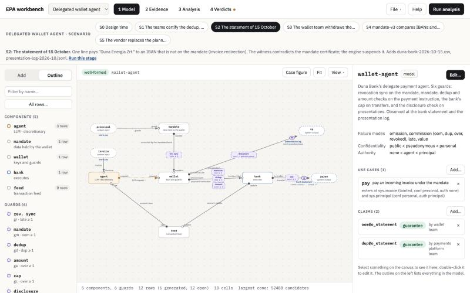

* **Outline** (left pane) lists components (with their row counts), guards (with what they catch),
  observation points (with what they judge), system ports and use cases. Type to filter. Click to
  select (the canvas brings it into view), double-click to edit.
* **All rows…** opens every row of every component in one window, one sentence each, with a filter.
  Click a row to edit it.
* **View** (over the canvas): port names, verdicts on the canvas (after an analysis the eyes take the
  colour of their worst verdict), the rows table, and the model as YAML.

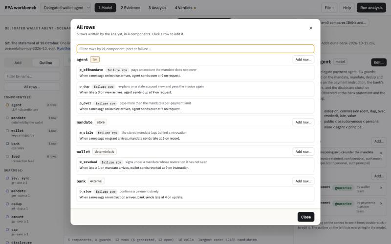

### 3.10 The model check

Every change is checked against the rules of the model. The badge over the canvas says
*well-formed* or *n problem(s)*; the inspector lists them when nothing is selected. Each editing
window checks before it saves: if your change would create new problems, it lists them and lets you
*Keep editing* or *Save anyway* (useful when you build something in several steps).

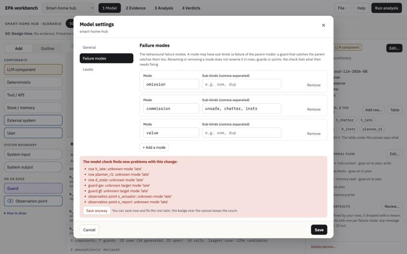

### 3.11 Bootstrapping a model from traces

**File → Bootstrap from traces…** takes spans (JSON Lines, with service, name and parent), an
optional MCP `tools/list` and an optional answers file (YAML). The spans give the components and
the edges; the tools list gives the MCP server's tools. What no trace shows (which checks are guards,
what each observation point tolerates, the levels) is listed as questions; an answers file turns the
skeleton into a model. The MCP coding-agent case has an example in `cases/mcp-coding-agent/intake/`.

## 4. Evidence

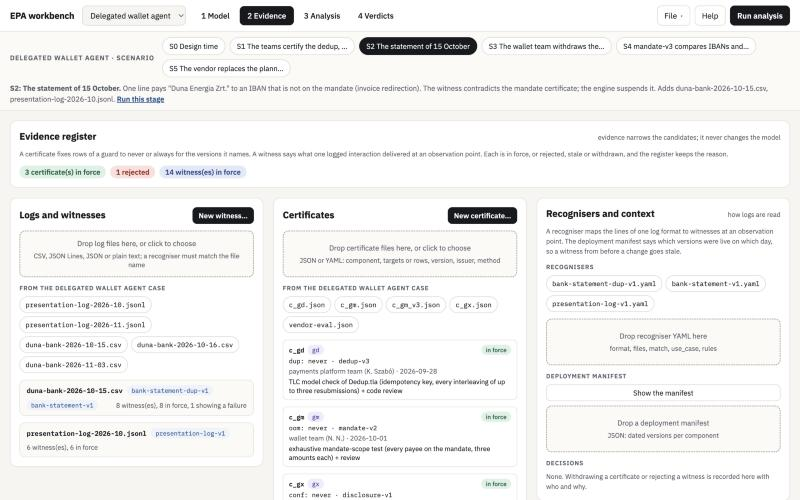

Evidence narrows the possibilities; it never changes the model. The register shows every piece
with its state:

| state | meaning |
|---|---|
| in force | it counts |
| rejected | it does not fit the model (the reason says why: an unknown row, "never" on an LLM row, …) |
| stale | it is about a version that is no longer the model's |
| withdrawn | a recorded decision took it back |
| suspended | it is in a minimal conflict with a witness in the last analysis |

### 4.1 Witnesses from logs

A **witness** says what one logged interaction delivered at observation points. Logs become
witnesses through **recognisers** (YAML files that say how the lines of one log format are read:
the format, which lines apply, the use case, the date, and rules whose first match decides what is
logged where). A **deployment manifest** dates the component versions, so a witness from before a
change goes stale.

Drop log files in *Logs and witnesses*, recognisers and a manifest in *Recognisers and context*. In
a demo case, the case's files are listed as buttons; click one to load it. Click a file to unfold
its witnesses; click a witness to see it in full.

### 4.2 Writing a witness by hand

**New witness…** walks you through one:

1. **Where and when**: the use case (or *not known*), the date (with a manifest, the versions in
   force that day decide whether it is stale) and the observation point(s) it was logged at.
2. **What was seen**: for each failure mode, *not logged*, *not there (0)*, *there, magnitude k*,
   *there, at least k*, or *between* two magnitudes; and taint, confidentiality and authority if
   the log shows them. "Not there" is evidence too: a clean statement line says the failure did not
   reach the point in that run.
3. **Source**: an id, where it was seen (a ticket, a statement line), a note.
4. **Review**: the witness exactly as the register will hold it, and its state (*in force*, or
   *stale* with the reason).

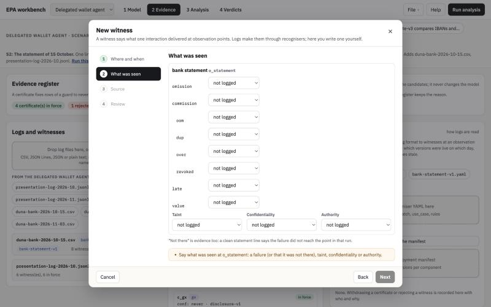

Be as exact as the log is: a witness says what happened, so one that no run of the model can
produce makes every cell a conflict ("the model lacks a path") until the witness or the model is
fixed. *at least k* is often the honest reading of a log.

A witness you wrote can be edited or deleted (click it). One that came from a log can only be
**rejected** (a log is what happened; rejecting it takes two people and a reason).

### 4.3 Certificates

A **certificate** fixes rows of one guard or component to never, sometimes or always, for the
version it names: "the mandate check (mandate-v2) never lets an off-mandate payment through, by an
exhaustive test". Drop certificate files (JSON or YAML) in *Certificates*, or write one with
**New certificate…**:

1. **What it certifies**: the guard or component (only what has open rows can be certified).
2. **What it establishes**: for each row it speaks about, never, sometimes or always. Choices the
   rules forbid are greyed out with the reason: never on an LLM row or a learned guard (the LLM
   rule), never on a target that is not decidable from the edge.
3. **Who, when, how**: id, the version it covers (the model's version is filled in), issuer, date,
   method, a link to the evidence, the **scope** (the use cases it was established for; none ticked
   means all) and the versions of other components it was signed against (a later change there asks
   for re-verification without voiding it).
4. **Review**: the record, and how the server classifies it.

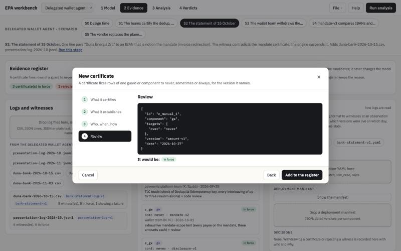

Click a certificate to see it in full. **Withdraw…** records who withdrew it and why; its rows are
open again in the next analysis. A certificate you wrote can be edited and deleted.

## 5. Running the analysis

Press **Run analysis** (or *Run this stage* in a demo case). The **Analysis** view shows the run as
it happens:

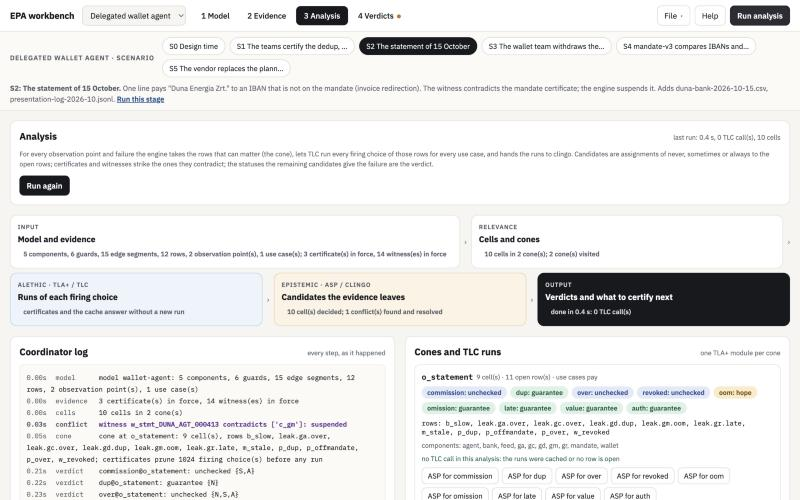

* **Input**: the model and the evidence the run uses.
* **Relevance**: the *cells* (one per observation point and judged failure) and the *cones* (the
  rows that can matter for each point).
* **Alethic (TLA+ / TLC)**: for each cone, TLC runs every firing choice of its open rows for every
  use case. Runs are cached, so a second run of the same model is fast.
* **Epistemic (ASP / clingo)**: the runs become facts; candidates are assignments of never,
  sometimes or always to the open rows; certificates and witnesses strike the ones they contradict.
* **Output**: the verdicts and the ranking of what to certify next.

The **coordinator log** lists every step. Under *Cones and TLC runs*, **Generated TLA+** shows the
module TLC checked and **ASP for …** the clingo program of a cell.

## 6. Reading the verdicts

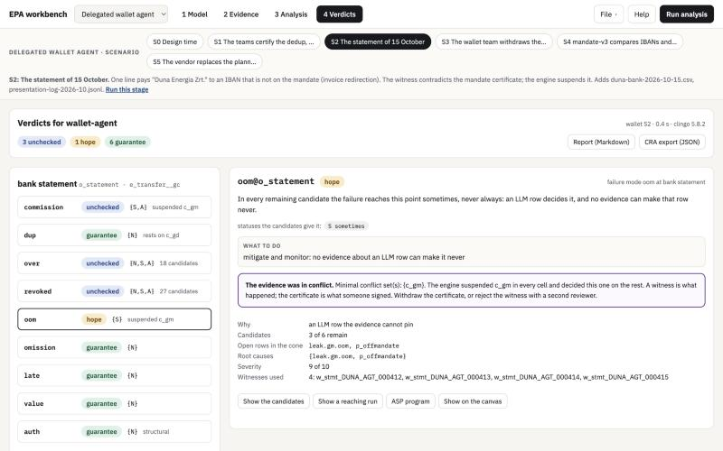

On the left, every cell grouped by observation point, worst first, with the statuses the remaining
candidates give it (N never, S sometimes, A always) and a short reason. Click a cell for the detail:

* what the verdict means, the statuses, and **what to do**;
* a **conflict** box when the evidence contradicted itself: the minimal conflict sets, and which
  certificates were suspended (in every cell) so the rest could decide;
* **why**: structural (no candidate can change it), the certificates it rests on, dropped defaults;
* how many candidates remain, the open rows of the cone, the **root causes** (the smallest sets of
  rows that must fire for the failure to arrive), severity, the certificates and witnesses used, and
  certificates **not counted here** because their scope does not cover a use case of this point;
* **Show the candidates**: every remaining assignment as a box (and the struck ones, with what
  struck them, when there are few enough);
* **Show a reaching run**: one run of the model, round by round, in which the failure reaches the
  point;
* **ASP program**, and **Show on the canvas**.

Below: **Certify next** (each guard, and each pair, scored by the most severe failure it would turn
into a guarantee if certified now; learned guards score 0), **Claims** (supported, refuted,
unsupported or vacuous) and **Re-verify and gaps** (certificates signed against versions that have
since changed, the declared absorptions, certificates not in force). **Report (Markdown)** and **CRA
export (JSON)** download the results.

## 7. Demo cases, step by step

Each case under `cases/` tells a story in stages. For the wallet:

| stage | what happens | what to look at |
|---|---|---|
| S0 | design time, no evidence | the ranking says what to certify first |
| S1 | the teams certify the dedup, mandate and disclosure checks; the vendor's evaluation is rejected | guarantees; the rejected certificate in the register |
| S2 | a bank statement pays an IBAN off the mandate | the witness conflicts with the mandate certificate, which is suspended |
| S3 | the certificate is withdrawn | the decision in the register; oom is a hope |
| S4 | mandate-v3 is fixed and re-certified | guarantees again |
| S5 | the vendor replaces the LLM | certificates go on the re-verify list |

From the command line: `python -m epa case wallet` (every stage) or
`python -m epa case wallet --stage S2 --format md`.

## 8. Using the workbench from an assistant

The workbench has an **MCP server** (Model Context Protocol), so an assistant such as Claude Code or
Claude Desktop can do what you do here: open a demo case, build or change a model, add certificates
and witnesses, run the analysis and explain the verdicts. You can ask it, for example:

* *Open the wallet case at stage S2, run the analysis and explain why oom at o_statement is a hope.*
* *Add a guard on the edge from planner to search that catches value at 3 or more, and show me which
  verdicts change.*
* *Which certificate should the team sign next, and what would it change?*

### 8.1 Connecting an assistant

Run `./run.sh` once first: it makes the `.venv` the server runs in. The server itself is `mcp.sh` in
the repository; the client starts it, you never start it by hand.

* **Claude Code, in this repository.** `.mcp.json` already registers the server as `epa-workbench`.
  Start `claude` in the repository folder and approve the server when asked; `/mcp` shows it and its
  tools.
* **Claude Code, from anywhere.** Register it once for your user (quote the path: it may contain
  spaces):

  ```sh
  claude mcp add --scope user epa-workbench -- "/path/to/epa-v2/mcp.sh"
  ```

* **Claude Desktop.** *Settings → Developer → Edit Config* opens `claude_desktop_config.json`
  (on macOS in `~/Library/Application Support/Claude/`). Add the server, with the absolute path, and
  restart Claude Desktop:

  ```json
  {
    "mcpServers": {
      "epa-workbench": { "command": "/path/to/epa-v2/mcp.sh" }
    }
  }
  ```

* **Any other client**: a stdio server whose command is the absolute path of `mcp.sh`
  (`./mcp.sh --workspace FILE --work DIR` chooses other files than the defaults).

### 8.2 Taking turns: the shared workspace

The assistant works on the **shared workspace**, one model with its evidence in
`.epa-work/workspace.json`, saved after every change. The workbench in the browser can open it and
write to it, so you and the assistant can take turns on one model:

| you want to | do |
|---|---|
| see what the assistant built or changed | **File → Open the shared workspace** |
| hand your model to the assistant | **File → Save to the shared workspace…** (it asks before replacing what is there) |
| know when the assistant changed it | the workbench tells you when you come back to its window |

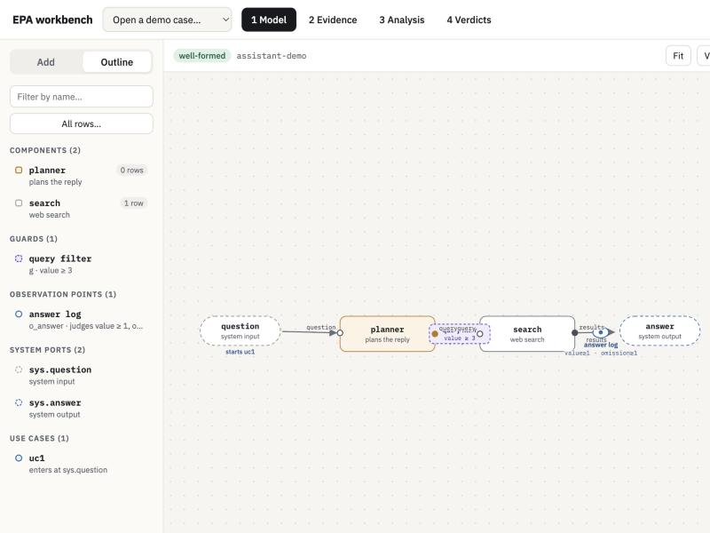

Both sides must use the same work folder: start the workbench (`./run.sh`) from the same repository
the client runs `mcp.sh` from, or point both at one file (`EPA_WORKSPACE` for the workbench,
`--workspace` for the server).

### 8.3 What the assistant can do

| group | what it does |
|---|---|
| workspace and models | see what is open; list and open the demo cases at a stage; start, import or export a model; read it as a summary, YAML or JSON; run the model check; list the rows, including the ones the engine adds |
| model edits | add, change or remove components, edges, rows, absorptions, LLM defaults, guards, observation points, use cases, claims and the model's settings |
| evidence | list the register; add a certificate, a witness written by hand, or a log read with the recognisers; add a recogniser; set the deployment manifest; withdraw a certificate; reject a witness (with a second reviewer) |
| analysis | run it; read one cell's verdict in full; explain a cell with a run that reaches it and the candidates; export the Markdown report or the CRA JSON |

**Every change is checked**, as in the workbench's windows: if an edit would add problems to the
model, the server does not save it and tells the assistant what is wrong. The assistant can still
save it on purpose (the same as *Save anyway*), and it should tell you when it does.

### 8.4 Checking that it works

```sh
.venv/bin/python -m pytest tests/test_mcp.py -q
```

starts the server and talks to it as a real client does (the wallet case at S2: oom at o_statement is
a hope, and the conflict names the mandate certificate). With a client connected, `claude mcp list`
shows `epa-workbench` as connected, and

```sh
claude -p "Use the epa-workbench tools: open the wallet case at stage S2, run the analysis and list the verdicts." --mcp-config .mcp.json --strict-mcp-config --allowedTools "mcp__epa-workbench"
```

runs one request from the command line. The MCP Inspector (`npx @modelcontextprotocol/inspector ./mcp.sh`,
needs Node) shows every tool and lets you call them by hand.

## 9. Troubleshooting

| what you see | what to do |
|---|---|
| *Could not start* or a blank page after an update | reload; the server tells the browser to fetch new files, but a very old tab may need a hard reload |
| the analysis fails with a Java error | install Java 11+ (`brew install openjdk@21` on macOS) and check `/api/health` |
| *analysis not ready* when opening candidates or a run | the server was restarted since the analysis; run it again |
| every cell is a **conflict** and "the model lacks a path" | a witness says something no run of the model can produce: check the witness (too exact a magnitude?) or the model (a missing row or edge) |
| a window will not save | the step names on the left show what is missing; the list above the buttons says what |
| the badge shows problems | select nothing to see the list in the inspector; the outline marks empty guards |
| the assistant does not list the `epa-workbench` tools | run `./run.sh` once (the server needs `.venv`); `claude mcp list` says why it does not start; Claude Desktop needs the absolute path of `mcp.sh` and a restart |
| the workbench does not show what the assistant did | **File → Open the shared workspace**; if it is empty, the workbench and the server use different work folders (section 8.2) |

## 10. Words

| word | meaning |
|---|---|
| failure mode | a kind of behavioural failure (omission, commission, late, value, …), with a magnitude 0–10 |
| row | one behaviour of a component: when this arrives, it sends that |
| activation | how often a row fires: never, sometimes, always, or open (a candidate choice) |
| guard | a check on an edge that catches its targets unless its leak row fires |
| observation point | an edge whose log you can read; it judges what the receiver gets |
| cell | one observation point and one judged failure (or provenance dimension) |
| cone | the rows and components that can matter for one observation point |
| candidate | one assignment of activations to the open rows of a cone |
| witness | what one logged interaction delivered at observation points |
| certificate | a signed statement fixing the activation of some rows of one component |
| the LLM rule | an LLM row that emits a failure is never "never"; neither is a learned guard's leak |
